# Open-Source Reinforcement Learning Self-Righting Robot

[简体中文](README.md) · English

**Community: Dengge Open-Source Reinforcement Learning QQ Group 8 · 1056677085**

This electronic self-righting robot uses a reinforcement learning policy to stand up after being pushed over. Build one with an ESP32, a BNO055 and two MG90S servos, with a DIY materials budget .

Start with the motion policy ([ONNX file](policy/selfrising-get-up.onnx)) provided here and follow the [tutorial](#step-1) to try it on hardware. Then follow the [tutorial](#step-1) to train your own policy with reinforcement learning or imitation learning.

This small robot covers simulation setup, reinforcement learning policy training, evaluation and hardware deployment: a hands-on introduction to learning-based robot control.

**Want to try it in simulation first? Push it over and watch it stand back up.**

**[Try the online simulation](https://sim2real.stackforce.cc/?example=selfrising-2axis&autoplay=0&step=mujoco&panel=simulation)**

## Build Tutorial

These seven steps take you through assembly, wiring and calibration, then run the open, pre-trained policy on the real robot. Once it works, try training your own get-up policy.

1. [Get the parts: full DIY or kit](#step-1)
2. [Print four parts and assemble](#step-2)
3. [Install ESP32 firmware through the website](#step-3)
4. [Wire and power the robot](#step-4)
5. [Calibrate the servos and mount the BNO055](#step-5)
6. [Upload and run the policy](#step-6)
7. [Train your own policy with SimReady](#step-7)

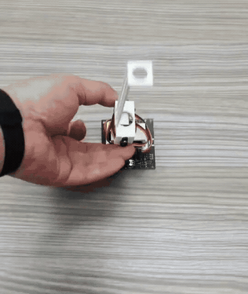

### 1. Get the parts: full DIY or kit

Build everything yourself or choose the matching kit, .

GBP figures are approximate conversions of the prices in China, excluding shipping. [Exchange-rate reference, 9 November 2026](https://www.oenb.at/isawebstat/stabfrage/createReport?lang=EN&report=2.14.9).

#### Full DIY, from sourcing to testing

Print the structure, source the electronics, then assemble, install firmware, wire and calibrate using the steps below. Printable models, a matching project and the motion policy are provided in this repository.

| Part | Quantity / purpose |
| --- | --- |
| Original ESP32 development board | 1; LOLIN32 Lite is shown in the wiring diagram |
| BNO055 orientation sensor | 1 |
| MG90S servo | 2, for the lower and upper joints |
| Separate regulated 5 V supply | For servos, with common ground to ESP32 |
| USB data cable, wires, screws and horns | One set |
| Four printed parts | Print from the supplied files |

#### Kit: compact, battery-powered, with wireless control and power-on operation

The integrated base keeps components together, supports battery power and wireless control, and can run the deployed policy automatically at power-on. **Ask the seller for the kit assembly guide.**

**[Click here to buy the kit on Taobao](https://e.tb.cn/h.jSReBRMxBI9FNul?tk=dqhs6cdMf8N)**

### 2. Print four parts and assemble

[Download the STL package](SelfRising-90S-STL.zip) and print in millimetres at 100% scale. [STEP models](SelfRising-90S-STEP.zip) are available for modifications.

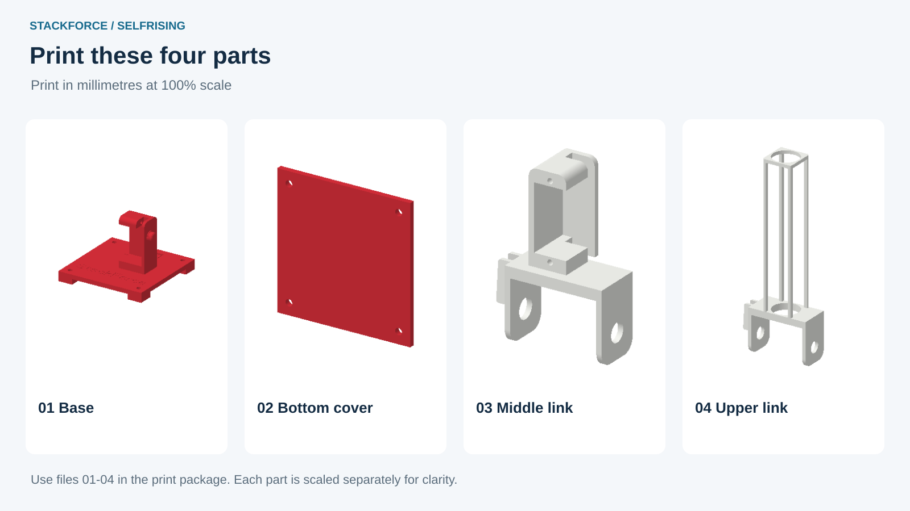

Print **1 Base, 2 Bottom cover, 3 Middle link and 4 Upper link**. Use the assembled model as a placement reference.

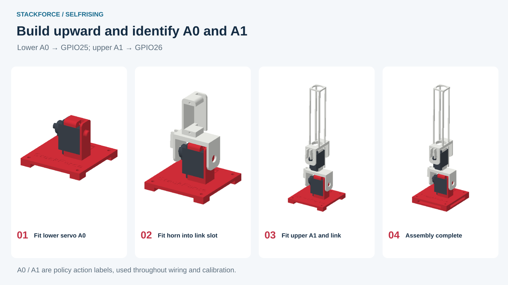

1. Fix the lower servo to the base.
2. Seat the included MG90S horn in the middle link's slot, then fit it to the lower servo shaft.
3. Fit the upper servo and use the horn in the upper link's slot to connect that link to the shaft.
4. Route the wires. Leave the horns temporarily fitted until neutral calibration and link alignment in step five, then tighten their centre screws.

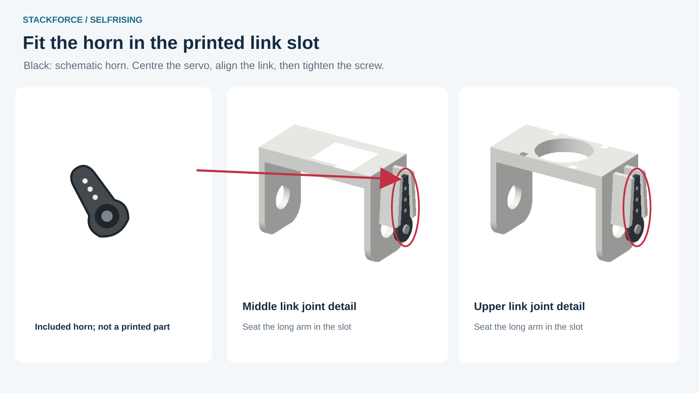

#### Servo action labels

| Servo location | Policy action | DIY signal pin |
| --- | --- | --- |
| Lower servo on the base | **A0** | **GPIO25** |
| Upper servo on the middle link | **A1** | **GPIO26** |

A0 and A1 are policy action labels, not pin labels printed on the ESP32. Wiring, mapping and calibration use A0 for the lower servo and A1 for the upper servo.

### 3. Install ESP32 firmware through the website

I built **[StackForce Sim2Real](https://sim2real.stackforce.cc/?example=selfrising-2axis&autoplay=0&step=sim2real&connection=usb&panel=devices)** to make hardware deployment easier. Use the website to install ESP32 firmware, connect devices and upload the policy.

#### 1. Open the website and load SelfRising

In desktop Chrome or Edge, open **[sim2real.stackforce.cc](https://sim2real.stackforce.cc/?example=selfrising-2axis&autoplay=0&step=sim2real&connection=usb&panel=devices)** and load the **SelfRising hardware example**. Alternatively, select Open Project at the right and load the [matching hardware project](https://github.com/Deng-ge-open-source/RL_SelfRisingRobot_StackForce/releases/download/v0.1.0-rc.1/SelfRising-ESP32.sim).

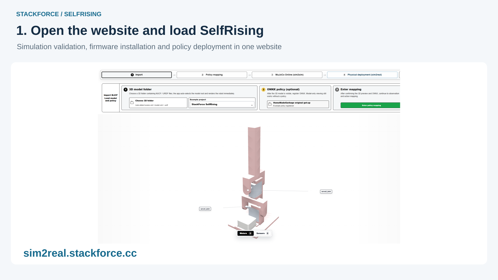

#### 2. Connect ESP32 over USB and install firmware

The DIY guide uses the pictured **LOLIN32 Lite / original ESP32**. Connect it with a USB data cable, enter Hardware Deployment → Devices & Mapping and select **Install Firmware** on the left.

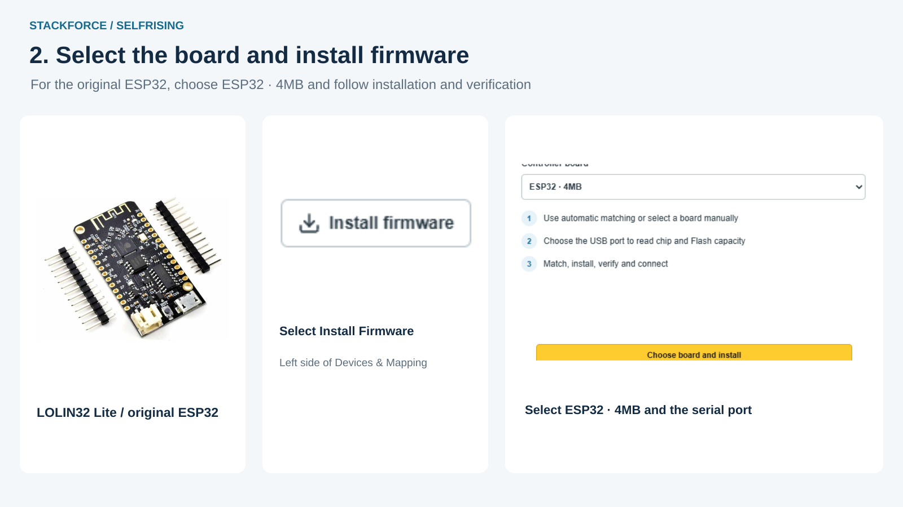

In the installer, select **ESP32 · 4MB**, then **Choose board and install** and choose the board's serial port. Wait for writing and verification, then select **USB Connect**. A board with the matching firmware already installed can connect directly.

### 4. Wire and power the robot

Disconnect power while wiring. Connect the BNO055 to ESP32, power the servos from a separate regulated 5 V supply and join the grounds.

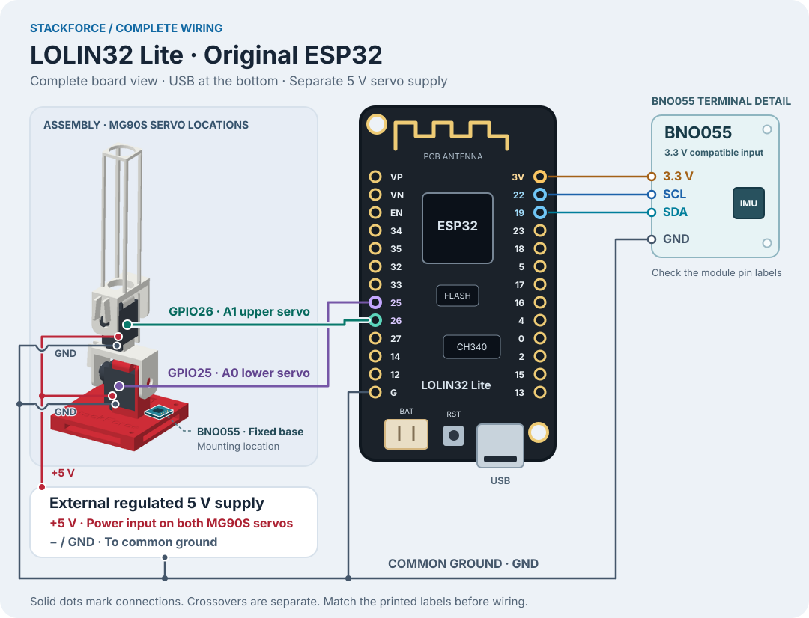

| Connection | Destination |
| --- | --- |
| GPIO19 / GPIO22 | BNO055 SDA / SCL |
| ESP32 3V3 / GND | BNO055 3.3 V-compatible power input / GND |
| GPIO25 | Lower servo A0 signal |
| GPIO26 | Upper servo A1 signal |
| External +5 V | Both servo positive power leads |
| Common GND | ESP32, BNO055, servos and supply negative |

Power up, select USB Connect and check for BNO055 data and two GPIO servo outputs. Kit users can follow the wiring instructions supplied by the seller.

### 5. Calibrate the servos and mount the BNO055

#### Centre first, then check direction

In Sim2Real Devices & Mapping, start with lower **A0**, then repeat for upper **A1**.

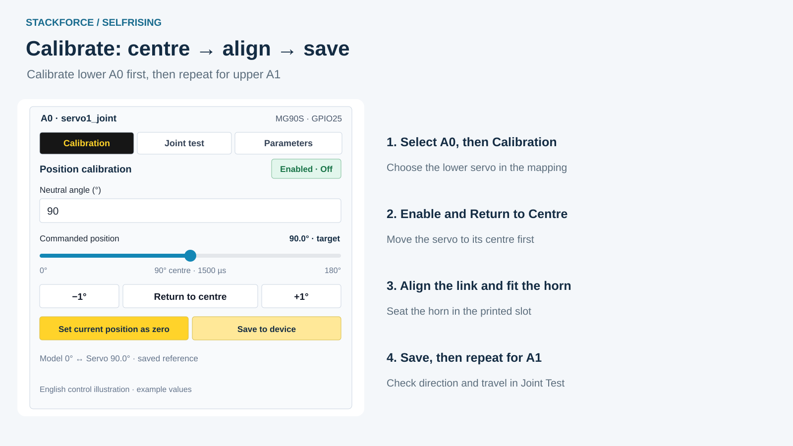

1. Open Calibration, enable that servo and select Return to Centre.
2. Align the link, seat the horn in its printed slot, secure it and save the neutral position.
3. In Joint Test, use small target changes to check direction and usable travel. Change the direction there if needed.
4. Save to the device and repeat for the other servo.

#### Fix the BNO055 to the base

| Matching kit | Full DIY |
| --- | --- |
| Plug the BNO055 into the dedicated connector and fix it as shown in the kit guide. | Fix the BNO055 at the base location shown in the 3D view. Wire 3.3 V, GND, SDA and SCL as in step 4. |
| Secure the module and connector so the sensor moves with the base. | Keep the sensor on the base, rather than the moving upper link. |

Select **BNO055** in the device tree and compare the 3D pose with the real robot. If its mounting orientation differs, adjust and save it there.

### 6. Upload and run the policy

The hardware project includes the policy and default mappings: **A0 → GPIO25 → lower servo; A1 → GPIO26 → upper servo**. Use the full project for reproduction; the separate [ONNX policy](policy/selfrising-get-up.onnx) is also available for inspection.

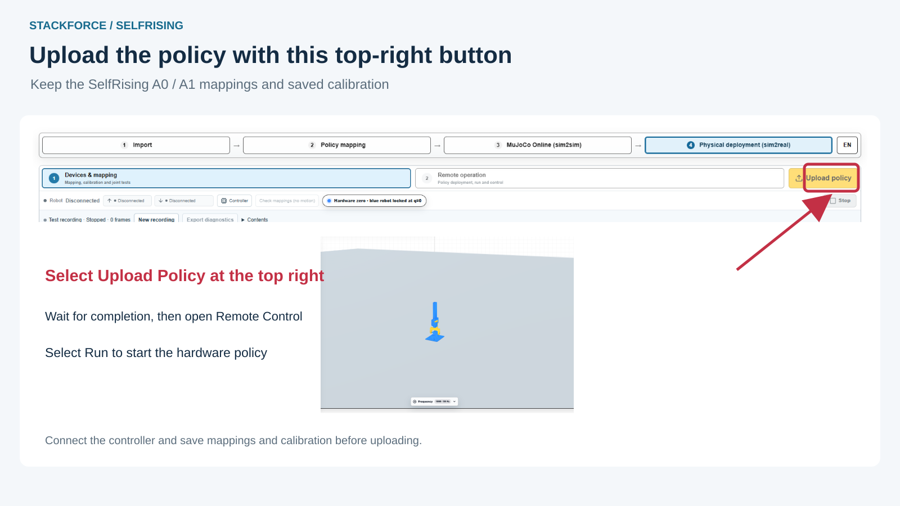

1. In Hardware Deployment → Devices & Mapping, select the **yellow Upload Policy button at the top right**, then wait for confirmation.
2. Open Remote Control, select Run and check the Running state reported by the board.
3. Leave room for the links and try a controlled fall. Select Stop when finished.

**[Watch the complete hardware get-up video](https://sim2real.stackforce.cc/example-media/selfrising/black-base-preview-10s.mp4)**

### 7. Train your own policy with SimReady

Once the supplied policy works on your robot, use **[StackForce SimReady](https://sim.stackforce.cc/?example=23)** to train your own. Configure the model, reference motions and training settings in the website, then run training on your computer.

Start with the **[SimReady introductory video on Bilibili](https://www.bilibili.com/video/BV1kVRzBEE2g/)** (Chinese).

#### 1. Load the SelfRising example

Select the SelfRising example to load the robot model and its two servo joints.

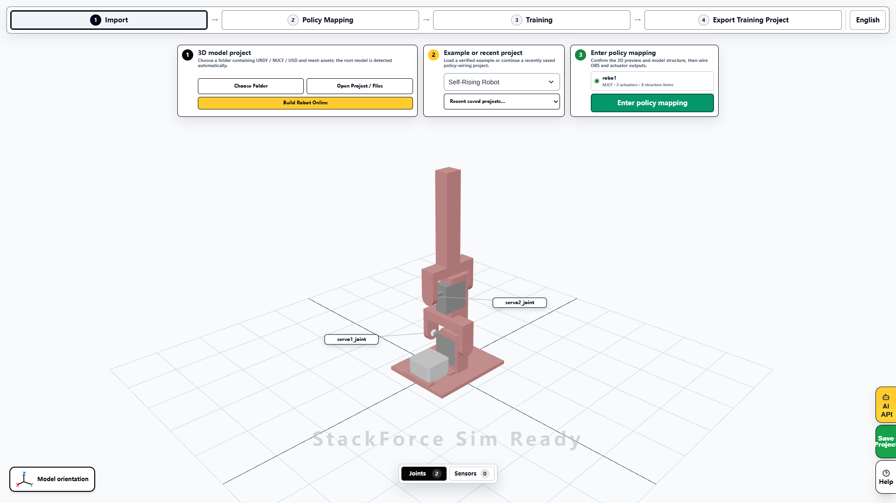

#### 2. Inspect and edit reference motions

Open Policy Mapping → Reference Motions. Preview front, rear, left and right recoveries. Select Edit Reference to adjust poses and timing using the timeline at the bottom.

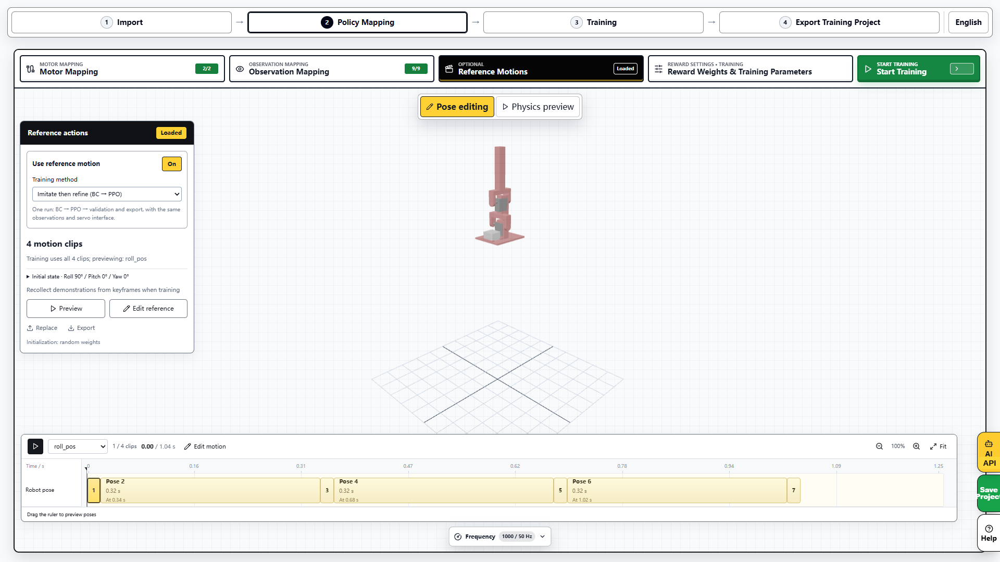

Keep the supplied motions for a first attempt, then modify keyframes, preview and save your own changes.

#### 3. Connect the runner and train

Open Training, start and connect the local runner, review the settings and select Start Training. Choose behaviour cloning or imitation followed by reinforcement learning. The connected computer performs the training.

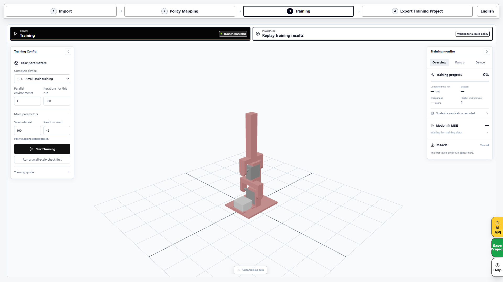

#### 4. Replay the result

Select Play Training Result on the training page and choose this job's model. Check recovery from all four directions.

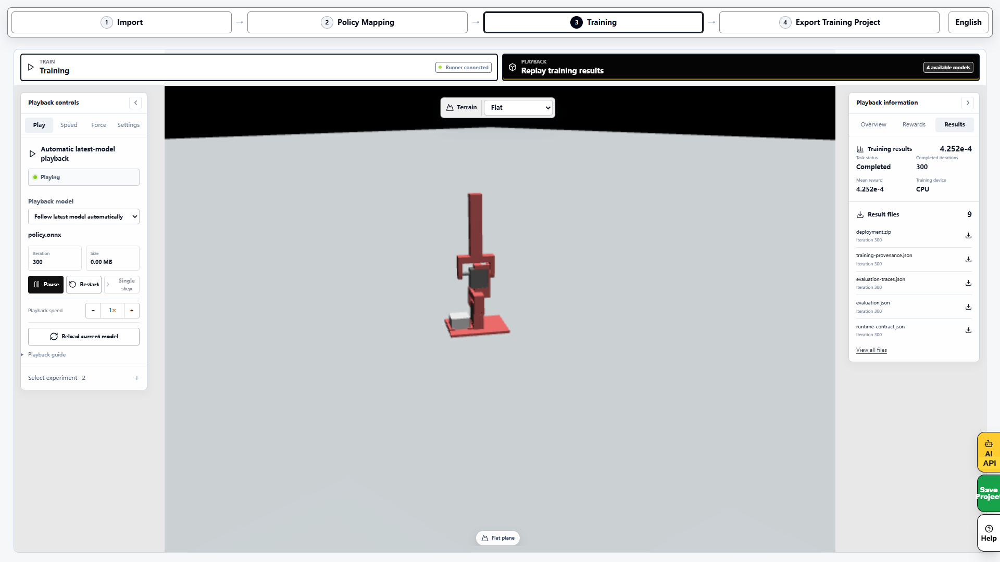

#### 5. Export the policy, training code and deployment project

Open Export Training Project and save the outputs you need.

| Output | Purpose |
| --- | --- |
| Trained ONNX policy | Control model for validation and deployment |
| Complete SimReady project | Model, reference motions and configuration for further editing |
| Local training project | Generated training code, environment and launch instructions |
| Local deployment package | Policy, model and runtime configuration for Sim2Sim / Sim2Real |

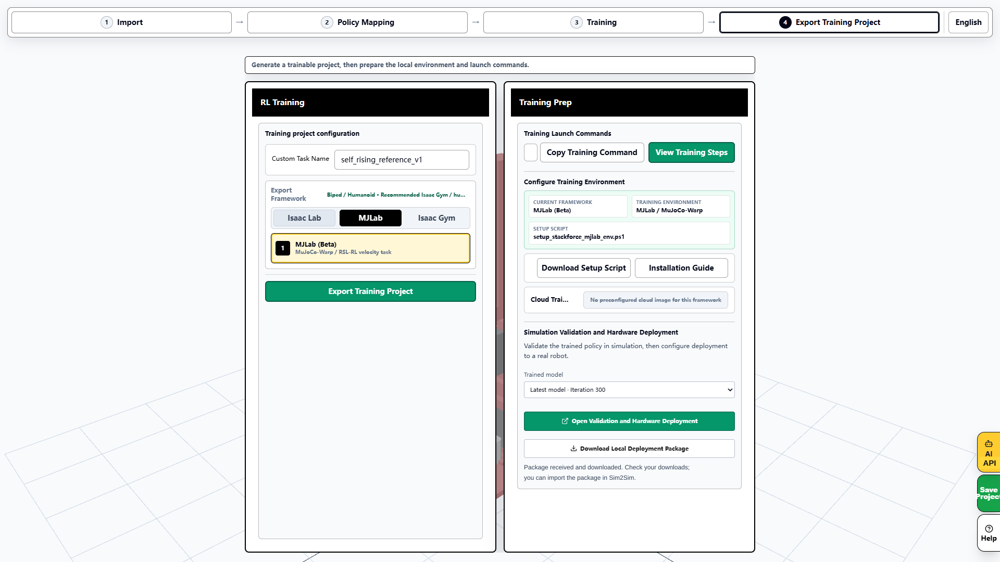

Simulation Validation and Hardware Deployment provides a one-click handoff: select the result and open it in **Sim2Sim for simulation validation**, then proceed to **Sim2Real for hardware setup**. Use the calibration, upload and run steps above on the hardware page.

> The current reference-training template has completed training, replay and export, but automatic handoff still has a compatibility issue to resolve. Use the supplied policy for hardware reproduction while retaining new training results for separate validation.

## Credits and Licence

The get-up policy originates from [HomeMadeGarbage's SelfRisingRobot](https://github.com/homemadegarbage/SelfRisingRobot). This project provides modified 90S designs, matching projects and reproduction instructions.

The modified printable designs use **GPL-3.0-only**. See [LICENSE.md](https://github.com/Deng-ge-open-source/RL_SelfRisingRobot_StackForce/blob/main/LICENSE.md) and [THIRD-PARTY-NOTICES.md](https://github.com/Deng-ge-open-source/RL_SelfRisingRobot_StackForce/blob/main/THIRD-PARTY-NOTICES.md) for other materials and upstream credits.
