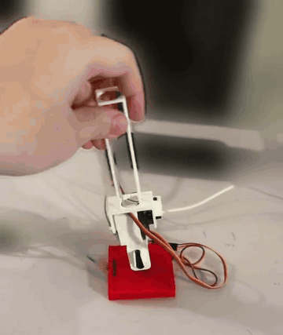
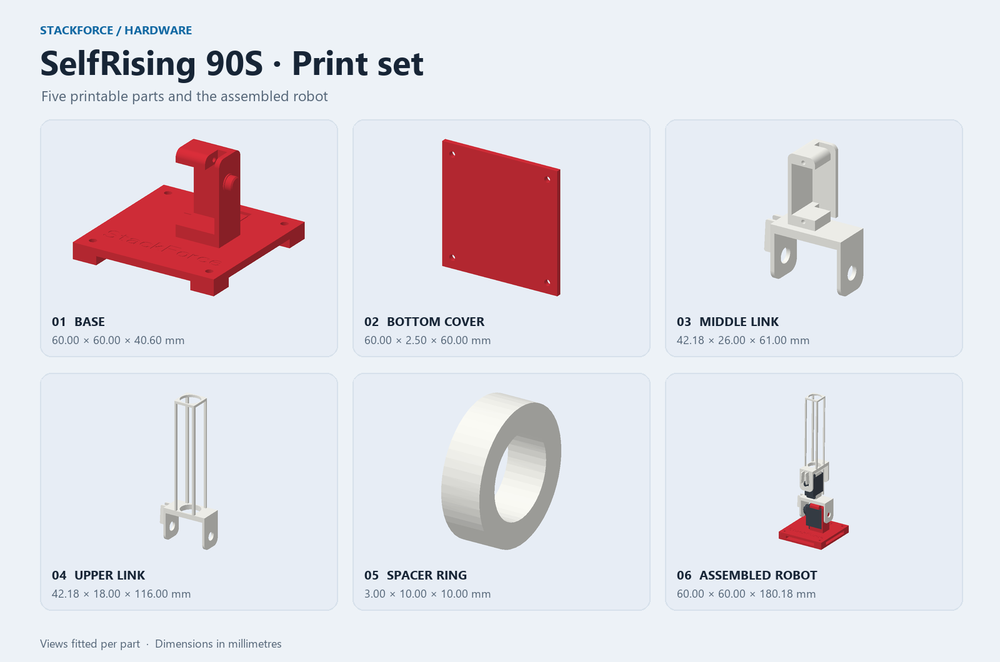
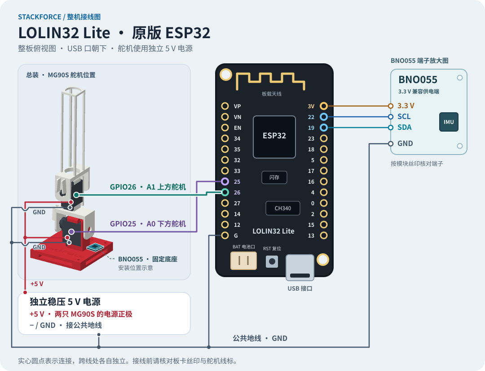
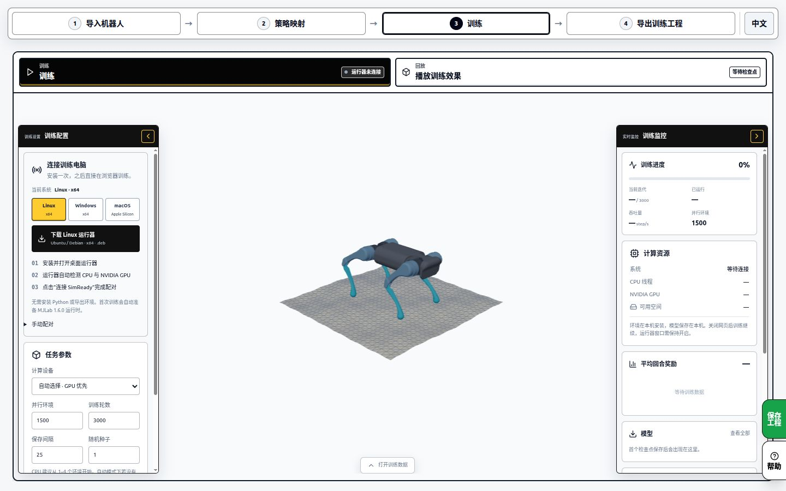

# 强化学习不倒翁 · StackForce SelfRising

简体中文 · [English](README.en.md)

打印五个零件，接上 ESP32、姿态传感器和两只舵机，再用 StackForce 把起立策略部署到桌面上的机器人。

| 从这里开始 | 你会完成什么 |
|---|---|
| [按首页搭建](#1-认板与备料) | 备料、打印、接线、校准和首次起立 |
| [训练图文教程](docs/training.zh-CN.md) | 配对 Runner、参考动作、BC→PPO、四方向回放和保存训练结果 |
| [运行图文教程](docs/running.zh-CN.md) | 网页仿真、新板固件、舵机与 IMU 校准、上传和运行 |

  

  <a href="#1-认板与备料">开始搭建</a> ·
  <a href="SelfRising-90S-STL.zip">下载打印包</a> ·
  <a href="https://sim2sim.stackforce.cc/?example=selfrising-2axis&amp;autoplay=0">在线仿真</a> ·
  <a href="https://sim2real.stackforce.cc/example-media/selfrising/red-base-preview-10s.mp4">观看完整实拍剪辑</a>

## 1. 认板与备料

实物示例使用 **LOLIN32 Lite 原版 ESP32** 和 CH340 USB 串口。把 USB 口朝下，对照整板图找到 `19`、`22`、`25`、`26`、`3V` 和 `G`。部分板卡把电源和地标为 `3V3`、`GND`。

接线图在第 3 步。接线时按手上板卡的丝印核对。 [完整实物照片](https://circuitpython.org/assets/images/boards/large/wemos_lolin32_lite.jpg) · [CircuitPython 板卡页面](https://circuitpython.org/board/wemos_lolin32_lite/) · [板卡原理图](https://done.land/assets/files/lolin32_lite.pdf)

| 准备 | 用途 |
|---|---|
| 1 块 LOLIN32 Lite 和 1 根 USB 数据线 | 安装固件、连接网站和运行策略 |
| 1 块支持 3.3 V 输入的 BNO055 模块 | 读取机身姿态 |
| 2 只 MG90S 舵机与配套舵盘、紧固件 | 下方关节 A0 和上方关节 A1 |
| **独立稳压 5 V 电源**和接线 | 给两只 MG90S 供电，电源负极与 ESP32 共地 |
| 5 个打印件 | 底座、底盖、中间连杆、上部连杆和轴套 |

想省去逐件采购，也可以购买套件，继续按下面的步骤装配和部署。所含物料见商品页清单。 [查看淘宝套件](https://e.tb.cn/h.jSReBRMxBI9FNul?tk=dqhs6cdMf8N)

## 2. 打印与试装

1. 下载打印包，把五个编号分件以 **毫米、100% 比例**导入切片器。底座和底盖用红色，连杆和轴套用白色。 [下载 STL 包](SelfRising-90S-STL.zip) · [零件与尺寸表](hardware/stl/README.md)
2. 对照右下角的整机图试装底座、两级连杆和轴套。舵盘先临时定位，在第 5 步对齐中位后再固定。 [整机 STL](hardware/stl/SelfRising-90S-assembled.stl) · [总装三视图](docs/images/selfrising-assembled.png)

## 3. 接线

断开电源后按表接线。电脑的 USB 数据线接 ESP32，两只舵机的电源正极接独立稳压 5 V。将 ESP32、BNO055、两只舵机和 5 V 电源负极接到共地。BNO055 使用模块标明支持 3.3 V 的供电端。

将 BNO055 固定在红色底座上，保持它与底座同步运动。图中标出安装区域，接线按模块丝印核对。

| 从这里 | 接到这里 |
|---|---|
| ESP32 `GPIO19` | BNO055 `SDA` |
| ESP32 `GPIO22` | BNO055 `SCL` |
| ESP32 `3V3` | BNO055 的 3.3 V 兼容供电端 |
| ESP32 `GPIO25` | 下方舵机 A0 的信号线 |
| ESP32 `GPIO26` | 上方舵机 A1 的信号线 |
| 外部稳压 `+5 V` | 两只舵机的电源正极 |
| 共地 `GND` | ESP32、BNO055、两只舵机和外部电源负极 |

这些引脚与网站的 ESP32 实物模板一致。 [原版 ESP32 接线说明](https://github.com/Deng-ge-open-source/Stack_Force_Sim2sim/blob/05eee9528c15bb03257c3b7f3654a401d8bd1ffb/apps/mujoco-online/hardware/esp32-robot-controller/original/README.md)

## 4. 打开网站并连接板卡

1. 用桌面版 Chrome 或 Edge 打开 Sim2Real，在示例选择器加载 **强化学习不倒翁 · ESP32**。 [打开 Sim2Real](https://sim2real.stackforce.cc/)
2. 用 USB 数据线连接板卡。新板卡在「设备与映射」打开「安装固件」，点「选择板卡并安装」，选择该板对应的 CH340 串口。等到网页提示固件写入并校验完成。
3. 在「设备与映射」点「USB 连接」，选板卡串口。看到 BNO055 数据和两路 GPIO 舵机后继续。 [浏览器串口授权说明](https://developer.chrome.com/docs/capabilities/serial)

## 5. 校准两轴

1. 在「设备与映射」检查 **A0 → GPIO25**、**A1 → GPIO26**。机器人立正时，核对 BNO055 的安装方向和页面上的姿态显示。
2. 逐路校准舵机。回中后让连杆对齐模型的机械零位，再固定舵盘。用小幅点动确认实际转向和可用行程，然后保存校准。
3. 两轴的中位、方向和行程都确认后，点「上传策略」，等待网页显示上传结果。

## 6. 试一次起立

把底座放在稳固的平面上，给两级连杆留出运动空间。在「遥控操作」点击「运行」，确认板卡回报运行状态。先试一次停止和重新运行，再让机器人从一次受控倒伏开始，观察起立后是否回中。停止入口也在「设备与映射」。

| 看到的情况 | 先检查 |
|---|---|
| 串口列表为空 | 数据线是否支持传输、浏览器是否已选择正确的 CH340 串口 |
| BNO055 没有数据 | SDA/SCL 对应关系、供电和共地 |
| 舵机方向相反或接近卡住 | 点击停止，再核对对应轴的方向、机械零位和行程 |
| 页面提示先上传策略 | 返回「设备与映射」，上传当前工程的策略并等待确认 |

完整操作见[网页仿真与 ESP32 运行教程](docs/running.zh-CN.md)，其中包含新板固件安装、两轴校准、BNO055 安装方向和再次上电后的测试。

## 7. 训练自己的起立策略

1. 打开 [SimReady 的 SelfRising 训练入口](https://sim.stackforce.cc/?example=23)，检查 `robo1` 模型和两个舵机关节。
2. 在「训练」下载并配对本地 Runner。网页负责配置与显示，训练由电脑完成。
3. 检查四方向参考动作，选择「示范学习（BC）」或「模仿后强化（BC → PPO）」，核对参数后点「开始训练」。
4. 训练后逐方向回放，保存完整 `.simready` 和该任务提供的部署包，再检查目标运行端的输入输出支持。

截图使用已发布的通用 A1 教程界面。SelfRising 的默认从零参考工程为 9 输入、2 输出，使用参考时钟与增量动作。内置作者实物策略采用其配套起立控制流程。具体参数、训练记录、原版 PPO 命令和部署对应关系见[完整训练教程](docs/training.zh-CN.md)。

## 来源与许可

这套 90S 打印件由 StackForce SelfRising 实物设计者修改完成。五个打印件设计及其对应的可编辑 Creo 文件采用 GNU GPL v3.0（`GPL-3.0-only`）。 [打印件来源与许可](hardware/stl/README.md) · [GPL 正文](hardware/stl/COPYING)

起身策略源于 HomeMadeGarbage 的双轴机器人 *poco*。StackForce 版本把它接入通用 Sim2Sim 和 Sim2Real 流程，并提供 LOLIN32 Lite、BNO055 和 GPIO 舵机的实物配置。[原作者项目](https://github.com/homemadegarbage/SelfRisingRobot/tree/c344c2a4a1a51562247528d8aadcc0a527b6b103)
