# 开源强化学习不倒翁

简体中文 · [English](README.en.md)

**交流 QQ 群：灯哥开源强化学习交流群（8 群） · 1056677085**

这是一个采用强化学习策略控制的电子不倒翁，被推倒后还能自己站起来。用 ESP32、BNO055 和两只 MG90S 舵机，自制材料预算 ，就能动手搭一个。

你可以先使用本仓库提供的运动策略（[ONNX 文件](policy/selfrising-get-up.onnx)），按照[教程](#step-1)完成部署，体验不倒翁自动起立的效果。熟悉之后，再跟着[教程](#step-1)尝试强化学习或模仿学习，训练自己的起立策略。

别看它小，机器人学习控制的主要环节都能在这个项目里接触到：搭建仿真、训练强化学习策略、验证效果，再部署到实物。用一个桌面上的小机器人，就可以动手了解这些方法是怎么用起来的。

**想先在仿真里玩一玩？试着把它推倒，看看它怎么自己站起来。**

**[点击体验在线仿真](https://sim2real.stackforce.cc/?example=selfrising-2axis&autoplay=0&step=mujoco&panel=simulation)**

## 复现教程

下面共七步：先完成组装、接线和校准，用本仓库已经训练好的开源策略让实物不倒翁跑起来；熟悉之后，再试着训练自己的起立策略。

1. [准备零件：自行 DIY 或购买套件](#step-1)
2. [打印四个零件，组装不倒翁](#step-2)
3. [在网页上给 ESP32 烧录固件](#step-3)
4. [接线和供电](#step-4)
5. [校准舵机，装好 BNO055](#step-5)
6. [上传策略，让它站起来](#step-6)
7. [用 SimReady 训练自己的不倒翁强化学习策略](#step-7)

<table align="center">
<thead>
<tr><th align="center">红色底座 · DIY 款</th><th align="center">黑色底座 · 套件款</th></tr>
</thead>
<tbody>
<tr>
<td align="center"></td>
<td align="center"><a href="https://sim2real.stackforce.cc/example-media/selfrising/black-base-preview-10s.mp4">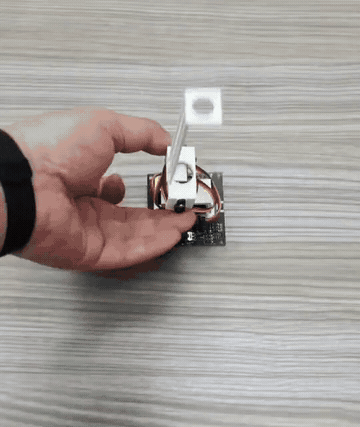</a></td>
</tr>
<tr><td align="center"><a href="https://sim2real.stackforce.cc/example-media/selfrising/red-base-preview-10s.mp4">观看红色款视频</a></td><td align="center"><a href="https://sim2real.stackforce.cc/example-media/selfrising/black-base-preview-10s.mp4">观看黑色款视频</a></td></tr>
</tbody>
</table>

### 1. 准备零件：自行 DIY 或购买套件

可以自行 DIY，也可以选择配套套件，。

#### 自行 DIY：从零件到调试，全流程自己动手

打印结构件、采购电子元件，再按下面的教程完成组装、烧录、接线和调试。打印文件、配套工程和运动策略都在本仓库中提供。

<table align="center">
<thead>
<tr>
<th align="center">物料</th>
<th align="center">数量与用途</th>
</tr>
</thead>
<tbody>
<tr>
<td align="center">原版 ESP32 开发板</td>
<td align="center">1 块；接线图以 LOLIN32 Lite 为例</td>
</tr>
<tr>
<td align="center">BNO055 姿态传感器</td>
<td align="center">1 块</td>
</tr>
<tr>
<td align="center">MG90S 舵机</td>
<td align="center">2 只，分别驱动上下关节</td>
</tr>
<tr>
<td align="center">独立稳压 5 V 电源</td>
<td align="center">给舵机供电，并与 ESP32 共地</td>
</tr>
<tr>
<td align="center">USB 数据线、连接线、螺丝和舵盘</td>
<td align="center">1 套</td>
</tr>
<tr>
<td align="center">四个打印零件</td>
<td align="center">下载文件后自行打印</td>
</tr>
</tbody>
</table>

#### 配套套件：更紧凑，支持电池供电、无线遥控和上电运行策略

套件采用集成底板，元件安装更集中，支持电池供电和无线遥控。完成策略部署后，也可以上电自动运行。购买套件后，可以**联系客服领取组装教程**。

**[点击进入淘宝购买链接](https://e.tb.cn/h.jSReBRMxBI9FNul?tk=dqhs6cdMf8N)**

### 2. 打印四个零件，组装不倒翁

[查看 STL 打印文件](hardware/stl/)，以毫米为单位、100% 比例打印。需要修改结构时，可以下载 [STEP 模型](hardware/step/)。

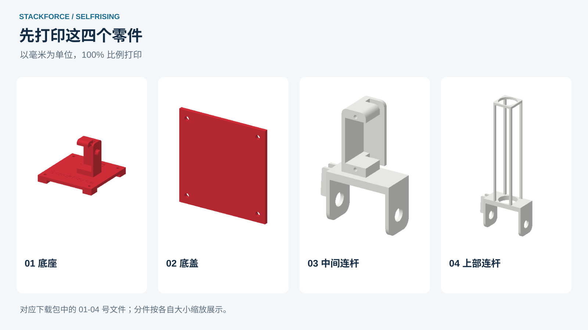

四个分件分别是：**① 底座、② 底盖、③ 中间连杆、④ 上部连杆**。整机模型用于对照装配位置，打印时使用这四个分件。

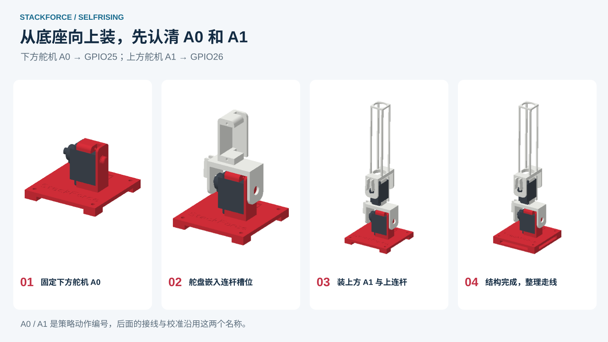

1. 把下方舵机固定在底座上。
2. 将 MG90S 随附的舵盘嵌入中间连杆的预留斜槽，再装到下方舵机上。
3. 安装上方舵机；上部连杆同样通过斜槽中的舵盘连接到舵机轴上。
4. 结构装好后整理走线。舵盘先临时安装，等第五步校准中位、对齐连杆后再拧紧中心螺丝。

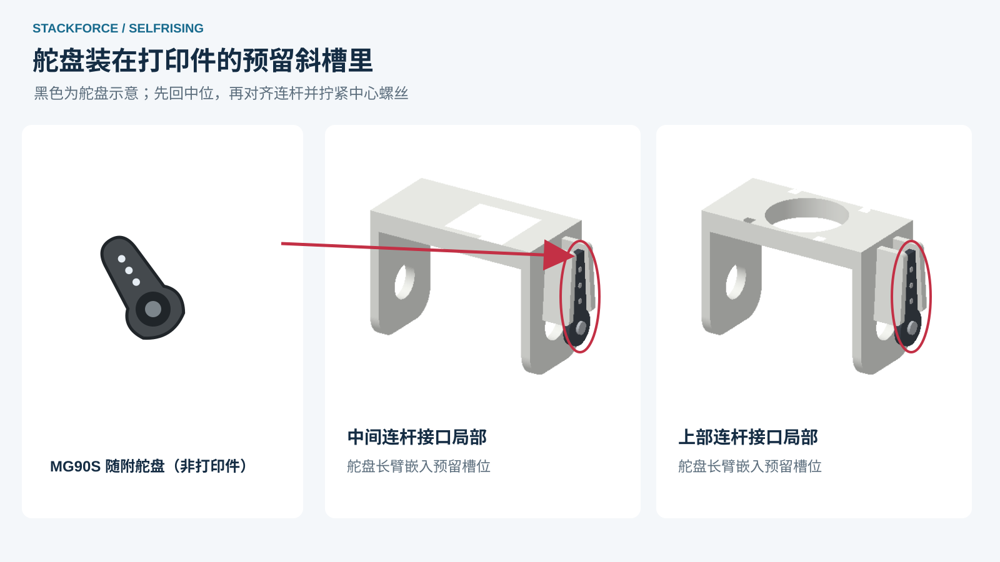

#### 两只舵机的编号

<table align="center">
<thead>
<tr>
<th align="center">舵机所在位置</th>
<th align="center">策略编号</th>
<th align="center">DIY 接线的信号脚</th>
</tr>
</thead>
<tbody>
<tr>
<td align="center">底座上的下方舵机</td>
<td align="center"><strong>A0</strong></td>
<td align="center"><strong>GPIO25</strong></td>
</tr>
<tr>
<td align="center">中间连杆上的上方舵机</td>
<td align="center"><strong>A1</strong></td>
<td align="center"><strong>GPIO26</strong></td>
</tr>
</tbody>
</table>

A0、A1 是策略的两路动作编号，不是 ESP32 上印着的引脚名。后面的接线、映射和校准都用这两个编号：看到 A0 就找下方舵机，看到 A1 就找上方舵机。

### 3. 在网页上给 ESP32 烧录固件

为了方便大家把强化学习策略部署到实物，我做了一个 **[StackForce Sim2Real 网站](https://sim2real.stackforce.cc/?example=selfrising-2axis&autoplay=0&step=sim2real&connection=usb&panel=devices)**。打开网页就能给 ESP32 烧录固件，连接传感器和舵机，再上传强化学习策略。

#### ① 打开网站，载入不倒翁示例

用电脑上的 Chrome 或 Edge 打开 **[sim2real.stackforce.cc](https://sim2real.stackforce.cc/?example=selfrising-2axis&autoplay=0&step=sim2real&connection=usb&panel=devices)**。在“示例工程”中载入 **SelfRising 不倒翁实物示例**，也可以点击页面右侧“打开工程”，选择本仓库的[配套实机工程](https://github.com/Deng-ge-open-source/RL_SelfRisingRobot_StackForce/releases/download/v0.1.0-rc.1/SelfRising-ESP32.sim)。

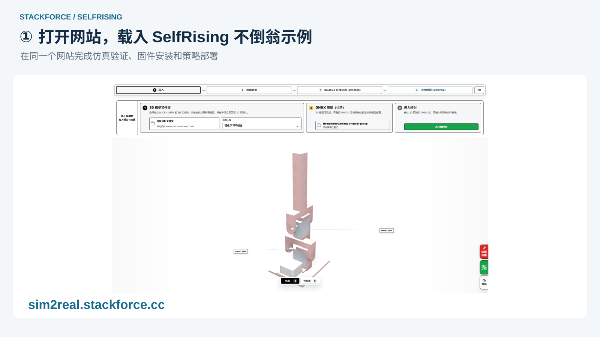

#### ② 用 USB 连接 ESP32，安装固件

DIY 使用图中的 **LOLIN32 Lite / 原版 ESP32**。用 USB 数据线把开发板接到电脑，进入“实物部署 → 设备与映射”，点击左侧的 **“安装固件”**。

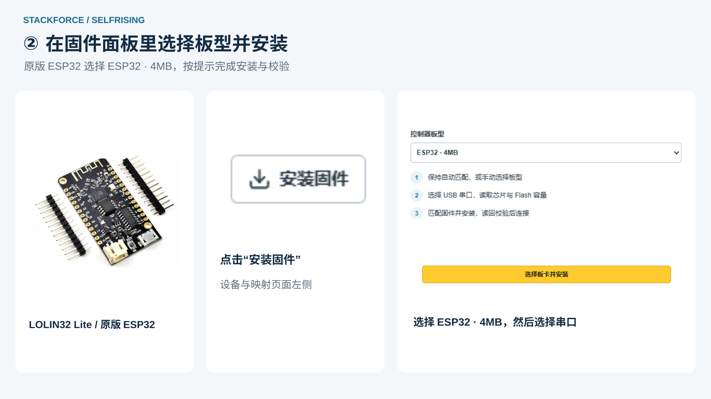

在固件面板选择 **ESP32 · 4MB**，点击 **“选择板卡并安装”**，在弹窗中选中开发板串口。等待写入和校验完成，再点击 **“USB 连接”**。已经安装好配套固件的板卡直接连接即可。

### 4. 接线和供电

断电后照图接线。BNO055 接 ESP32，舵机由独立稳压 5 V 电源供电，各设备共地。

<table align="center">
<thead>
<tr>
<th align="center">接口</th>
<th align="center">连接位置</th>
</tr>
</thead>
<tbody>
<tr>
<td align="center">ESP32 GPIO19 / GPIO22</td>
<td align="center">BNO055 SDA / SCL</td>
</tr>
<tr>
<td align="center">ESP32 3V3 / GND</td>
<td align="center">BNO055 的 3.3 V 兼容供电端 / GND</td>
</tr>
<tr>
<td align="center">ESP32 GPIO25</td>
<td align="center">下方舵机 A0 的信号线</td>
</tr>
<tr>
<td align="center">ESP32 GPIO26</td>
<td align="center">上方舵机 A1 的信号线</td>
</tr>
<tr>
<td align="center">外部 +5 V</td>
<td align="center">两只舵机的电源正极</td>
</tr>
<tr>
<td align="center">共地 GND</td>
<td align="center">ESP32、BNO055、两只舵机和外部电源负极</td>
</tr>
</tbody>
</table>

接好后通电，回到网站点击“USB 连接”，检查设备树里是否能看到 BNO055 和两路 GPIO 舵机。套件用户按客服提供的接线教程完成插接。

### 5. 校准舵机，装好 BNO055

#### 先调舵机中位，再检查正反向

在 Sim2Real 的“设备与映射”页面，先选择下方 **A0**，再用同样的方法调上方 **A1**。

1. 打开当前舵机的“校准”，使能后点击“回到中位”。
2. 对照装配图把连杆摆正，将舵盘嵌入打印件斜槽并固定，保存当前中位。
3. 切到“联动”，小幅点动关节。方向相反就在这里切换正反向，同时检查实际可用行程。
4. 保存到设备，再调另一只舵机。

#### BNO055 固定在底座上

<table align="center">
<thead>
<tr>
<th align="center">配套套件</th>
<th align="center">自行 DIY</th>
</tr>
</thead>
<tbody>
<tr>
<td align="center">将 BNO055 插入预留接口，按套件组装教程固定。</td>
<td align="center">将 BNO055 固定在三维图标出的底座位置，按第四步连接 3.3 V、GND、SDA、SCL。</td>
</tr>
<tr>
<td align="center">不让模块和接头松动，传感器跟随底座一起运动。</td>
<td align="center">模块不能装到上方活动杆上；它需要跟随底座一起运动。</td>
</tr>
</tbody>
</table>

装好后，在网页设备树中点击 **BNO055**，对照实物检查三维姿态。如果安装朝向与示例不同，在这里调整安装方向并保存。

### 6. 上传策略，让它站起来

配套实机工程已经包含运动策略和默认映射：**A0 → GPIO25，下方舵机；A1 → GPIO26，上方舵机**。正常复现直接使用工程即可，单独的 [ONNX 策略文件](policy/selfrising-get-up.onnx)也可以下载研究。

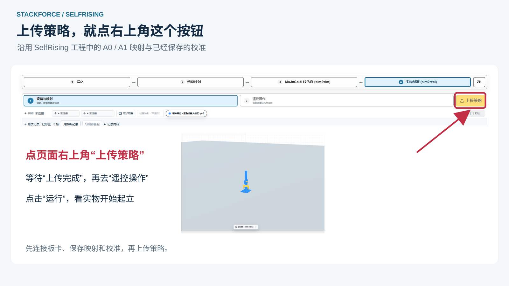

1. 在“实物部署 → 设备与映射”页面，点击**右上角黄色的“上传策略”按钮**，等待网页确认上传完成。
2. 进入“遥控操作”，点击“运行”，确认顶部回报“运行中”。
3. 在桌面上给连杆留出活动空间，试着推倒一次，观察它重新起立。需要结束时点击“停止”。

<table align="center">
<thead>
<tr><th align="center">红色底座 · DIY 款</th><th align="center">黑色底座 · 套件款</th></tr>
</thead>
<tbody>
<tr>
<td align="center"></td>
<td align="center"></td>
</tr>
<tr><td align="center"><a href="https://sim2real.stackforce.cc/example-media/selfrising/red-base-preview-10s.mp4">观看红色款视频</a></td><td align="center"><a href="https://sim2real.stackforce.cc/example-media/selfrising/black-base-preview-10s.mp4">观看黑色款视频</a></td></tr>
</tbody>
</table>

### 7. 用 SimReady 训练自己的不倒翁强化学习策略

[查看训练工程](Training/) · [查看 Sim-to-Sim 本地运行工程](Sim-to-Sim/)

配套策略跑通后，你也可以试着训练自己的起立策略。**[StackForce SimReady](https://sim.stackforce.cc/?example=23)** 是我开发的一款在线强化学习训练工具：导入机器人的三维模型，在网页里配置好观测、动作和训练参数，就能导出 **MJLab**、**[Isaac Lab（基于 Isaac Sim）](https://isaac-sim.github.io/IsaacLab/main/index.html)** 和 **Isaac Gym** 的强化学习工程。

除了导出强化学习工程，SimReady 还支持在网页中进行强化学习训练。你可以通过网页设置参考动作、调整训练参数并启动训练，训练完成后直接导出策略，用于后续的仿真验证和实物部署。

第一次使用，可以先看 **[SimReady 基础使用视频（B 站）](https://www.bilibili.com/video/BV1kVRzBEE2g/)**。

#### ① 加载不倒翁示例

打开 SimReady，在示例中选择“强化学习不倒翁 · Self-Rising”，加载后就能看到模型和两个舵机关节。

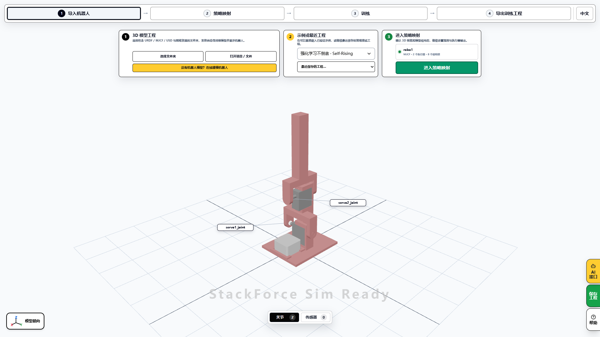

#### ② 查看、修改起立动作

进入“策略映射 → 参考动作”，查看前、后、左、右四个方向的起立片段。点击“预览参考”看动作；点击“编辑参考”，就能在页面底部的时间轴中调整姿态和动作时间。

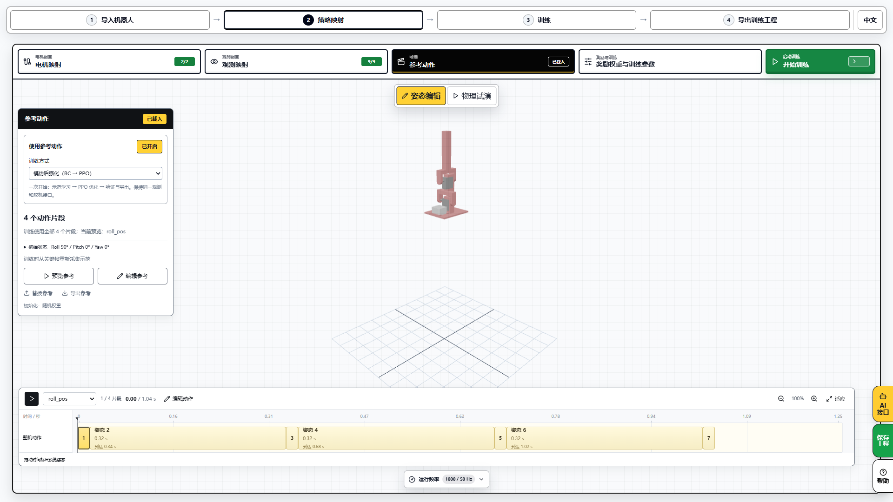

第一次可以沿用示例动作。想改变起立方式，再修改关键帧、预览动作，然后保存。

#### ③ 连接运行器，开始训练

进入“训练”，按网页提示启动本地训练运行器。确认连接成功、参数无误后，点击“开始训练”。可以选择示范学习，也可以选择模仿后强化学习，训练任务由你连接的电脑执行。

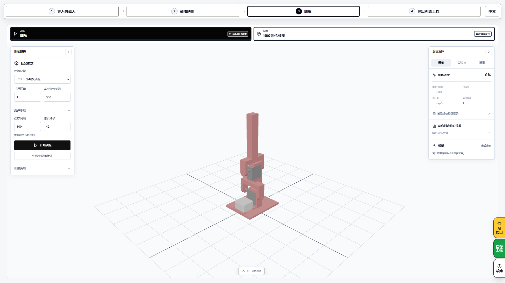

#### ④ 回放训练结果

训练结束后，在训练页点击“播放训练效果”，选择这次保存的模型，分别检查四个方向的起立效果。

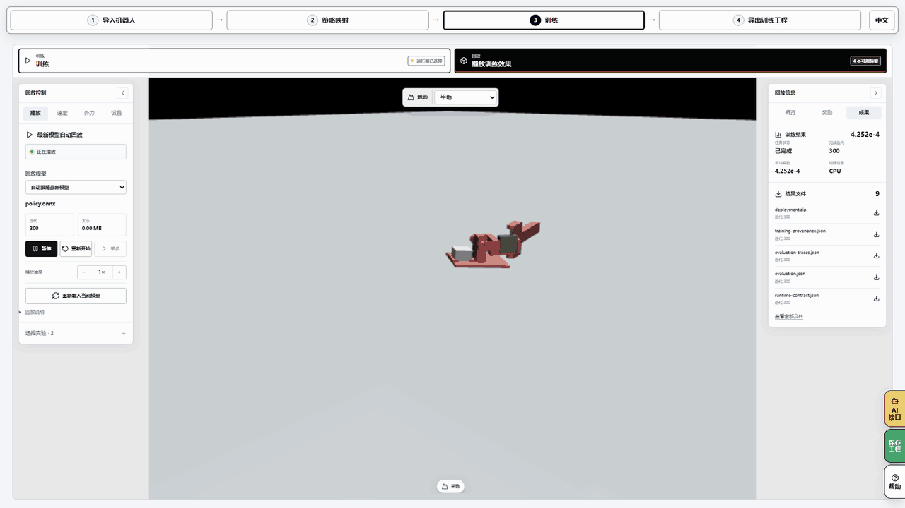

#### ⑤ 导出策略、训练代码和部署工程

进入“导出训练工程”，按需要保存以下内容：

<table align="center">
<thead>
<tr>
<th align="center">要保存什么</th>
<th align="center">用来做什么</th>
</tr>
</thead>
<tbody>
<tr>
<td align="center">训练好的 ONNX 策略</td>
<td align="center">保存控制模型，供后续验证和部署</td>
</tr>
<tr>
<td align="center">完整 SimReady 工程</td>
<td align="center">保留模型、动作与配置，方便继续修改</td>
</tr>
<tr>
<td align="center">本地训练工程包</td>
<td align="center">下载网站生成的训练代码和环境、启动说明，在本地继续开发</td>
</tr>
<tr>
<td align="center">本地部署包</td>
<td align="center">保存策略、模型和运行配置，交给 Sim2Sim / Sim2Real</td>
</tr>
</tbody>
</table>

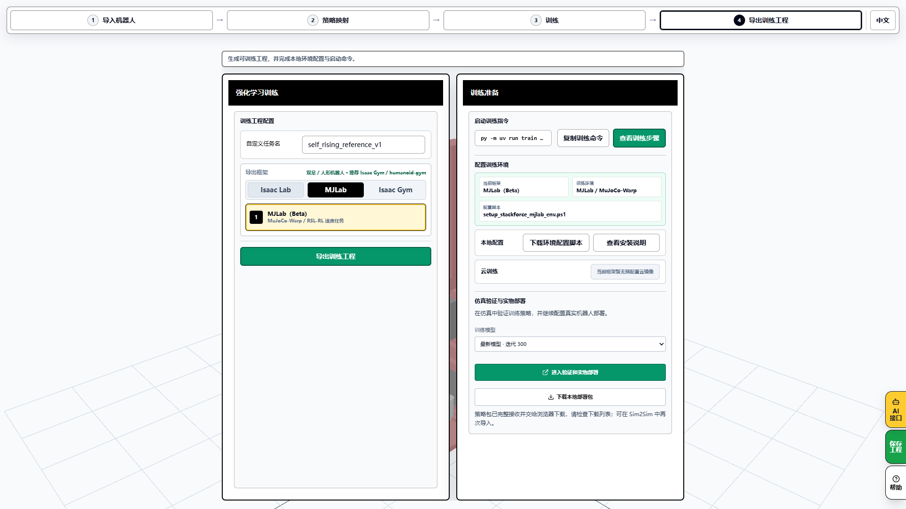

“仿真验证与实物部署”区域提供一键交接入口：选择训练结果，点击打开，就能把工程交给 **Sim2Sim 做仿真验证**，再进入 **Sim2Real 配置实物部署**。进入实物页面后，沿用前面的校准、上传和运行步骤。

> 当前参考训练模板已经完成训练、回放和导出，一键交接仍有兼容性问题待修复。现阶段可先用本仓库配套策略完成实物复现，自训结果另行保存、验证。

## 来源与许可

起立策略源于 [HomeMadeGarbage 的 SelfRisingRobot 项目](https://github.com/homemadegarbage/SelfRisingRobot)。本项目提供修改后的 90S 结构设计、配套工程和复现教程。

修改后的打印结构设计采用 **GPL-3.0-only**。其他资源的许可及第三方出处见 [LICENSE.md](https://github.com/Deng-ge-open-source/RL_SelfRisingRobot_StackForce/blob/main/LICENSE.md) 和 [THIRD-PARTY-NOTICES.md](https://github.com/Deng-ge-open-source/RL_SelfRisingRobot_StackForce/blob/main/THIRD-PARTY-NOTICES.md)。
