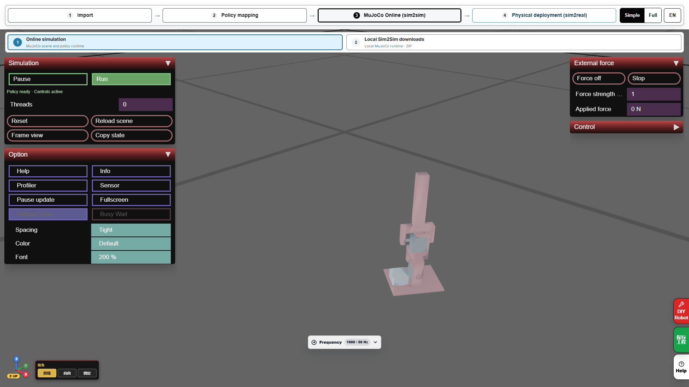
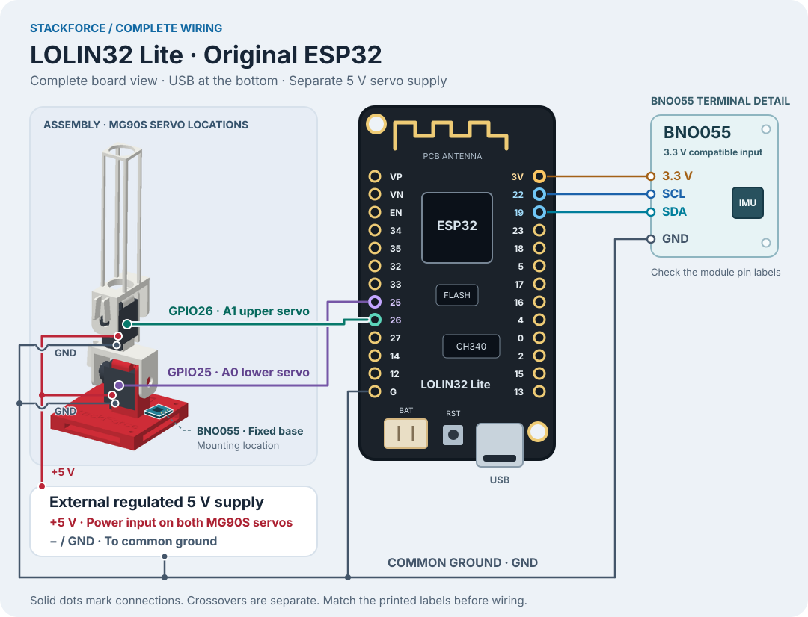
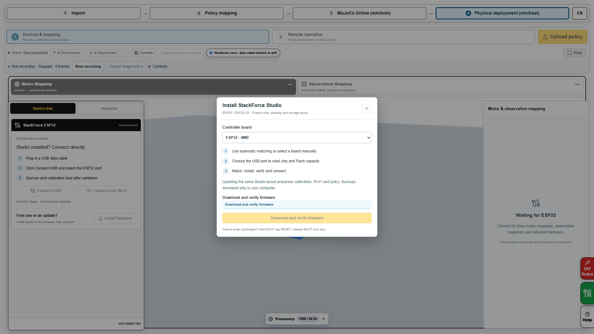
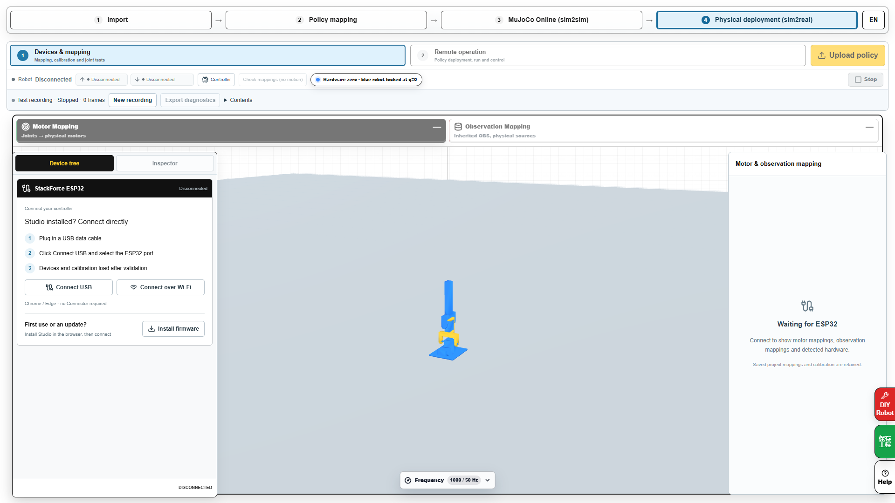
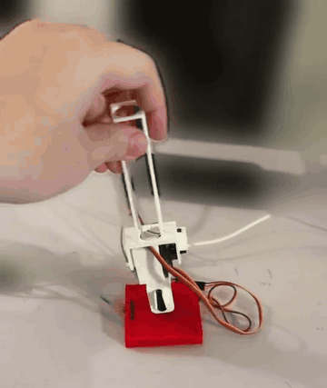

# Run SelfRising in simulation and on ESP32

[简体中文](running.zh-CN.md) · English · [Home](../README.en.md) · [Training guide](training.en.md)

[Download the firmware, hardware example and local runtime](downloads.en.md). Each controller retains its own calibration.

After training in SimReady, verify that model in Sim2Sim. The ESP32 steps here use the author's original SelfRising policy supplied with the website. Board validation of the newly trained nine-input reference policy is pending; see [training step 6](training.en.md#6-continue-to-hardware). **Upload policy** stores the project on the controller, **Run** starts execution and **Stop** ends outputs.

## 1. Try the web simulation

1. Open the [author's original SelfRising simulation](https://sim2real.stackforce.cc/?example=selfrising-2axis&autoplay=0&step=mujoco&panel=simulation). For handoff status of your own trained result, see [training step 5](training.en.md#5-open-sim2sim).
2. If the reproduction guide opens, select **Continue with current project**. Review joint and observation settings in **Policy Mapping**, then open **MuJoCo online simulation**.
3. Select **Run** and check that physics actually advances. Use the page's initial-pose or reset controls to test the four fall directions.
4. Test recovery in each direction, checking sustained stability after reaching the target pose.
5. Use **Save Project** to download a reopenable `.sim`. For local MuJoCo execution, use **Local Sim2Sim downloads** to obtain the `-mujoco.zip` bundle with its model, policy and launchers, then follow the bundled instructions.

## 2. Open the hardware project and wire it

Use desktop Chrome or Edge with serial access to open the [Sim2Real SelfRising example](https://sim2real.stackforce.cc/?example=selfrising-2axis&autoplay=0&step=sim2real&connection=usb&panel=devices) and check that the author's original policy is loaded. Record the policy version used for this hardware test.

<table align="center">
<thead>
<tr>
<th align="center">Part</th>
<th align="center">Wiring and mounting</th>
</tr>
</thead>
<tbody>
<tr>
<td align="center">BNO055</td>
<td align="center">Fix it to the red base. SDA → GPIO19, SCL → GPIO22, 3.3 V compatible power input → 3V, GND → common ground</td>
</tr>
<tr>
<td align="center">Lower MG90S A0</td>
<td align="center">Signal → GPIO25, power → external 5 V, ground → common ground</td>
</tr>
<tr>
<td align="center">Upper MG90S A1</td>
<td align="center">Signal → GPIO26, power → external 5 V, ground → common ground</td>
</tr>
<tr>
<td align="center">Separate 5 V supply</td>
<td align="center">Join its negative terminal to ESP32, BNO055 and both servo grounds</td>
</tr>
<tr>
<td align="center">ESP32 USB</td>
<td align="center">Connect a USB data cable to the computer for firmware installation, uploads and debugging</td>
</tr>
</tbody>
</table>

## 3. Install firmware on a fresh board and connect

1. In **Devices & Mapping**, open **Install firmware**. Select **Choose board and install**, then choose the ESP32's CH340 port in the browser serial picker.
2. Wait for writing and verification to finish, then release the installer connection.
3. Select **Connect USB** and choose the board's serial port again. The device tree should show the BNO055 and two GPIO servo channels.
4. Check the controller's reported state. If it is already executing a saved project, select **Stop** before editing mapping and calibration.

## 4. Map and calibrate both servos

1. Check `servo1_joint / A0 → GPIO25` and `servo2_joint / A1 → GPIO26`.
2. Start with A0. Open calibration, enable that servo and centre it. Align the link to the mechanical assembly and save zero.
3. Move the joint target slightly in the joint test and check the actual direction. Reverse and save it if needed.
4. Check that axis's usable travel, save it, then calibrate A1.

The GUI's nominal servo neutral is 90°. Model joint 0 rad corresponds to the saved mechanical zero, with calibration converting between them. GPIO virtual feedback estimates angle, so also observe the physical motion.

## 5. Calibrate the BNO055 mounting direction

1. Select BNO055 in the device tree and open the robot IMU 3D view.
2. Hold the robot in the model's upright pose. Adjust the sensor mounting direction relative to the base until the displayed orientation matches.
3. Make small Roll and Pitch movements separately, then check rotation around Z.
4. Save the mounting direction. Use the pose-zero control when establishing a display reference, then recheck the Roll/Pitch values in the observation slots.

## 6. Upload, run and stop

1. Select **Upload policy** and wait for the upload and validation result. If an error appears, check the model, observations and motor mapping it identifies.
2. Open **Remote Control**, select **Run**, and check both controller feedback and physical motion.
3. Try **Stop** once and confirm outputs end, then run again.
4. Begin from one controlled fall. Watch both servos complete recovery and return to neutral. Repeat by direction and record the outcome.

This existing hardware demo provides a motion reference. [Full demo clip](https://sim2real.stackforce.cc/example-media/selfrising/red-base-preview-10s.mp4)

The website reports upload and runtime results separately. Available control transports depend on the installed firmware and the device's reported capabilities. This guide uses USB throughout.

## 7. Save the configuration for another test

After saving servo and IMU calibration, download a `.sim` with **Save Project**. Next time, reopen it, connect the controller, check its policy, mapping and calibration feedback, then run. For power-on autostart, use the installed firmware's autostart settings and verify them with an actual power cycle.

<table align="center">
<thead>
<tr>
<th align="center">Symptom</th>
<th align="center">Check</th>
</tr>
</thead>
<tbody>
<tr>
<td align="center">Policy running but servos still</td>
<td align="center">Controller state, both output mappings, external 5 V and common ground, then the policy's input/output configuration</td>
</tr>
<tr>
<td align="center">Wrong direction or neutral</td>
<td align="center">That axis's direction, saved zero and physical travel in device mapping</td>
</tr>
<tr>
<td align="center">Fault after a small tilt</td>
<td align="center">Read the reported reason, then check BNO055 power, connectors and live data</td>
</tr>
<tr>
<td align="center">Motion jitters</td>
<td align="center">Record IMU, policy targets and estimated angles together, then inspect assembly and power to locate the source</td>
</tr>
<tr>
<td align="center">Newly trained policy will not upload</td>
<td align="center">Check its complete contract and target runtime support in <a href="training.en.md#6-continue-to-hardware">training step 6</a></td>
</tr>
</tbody>
</table>
