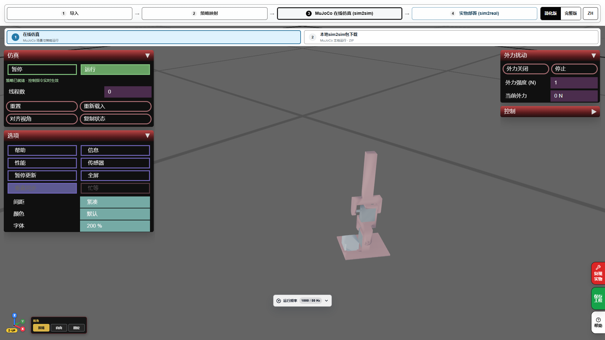
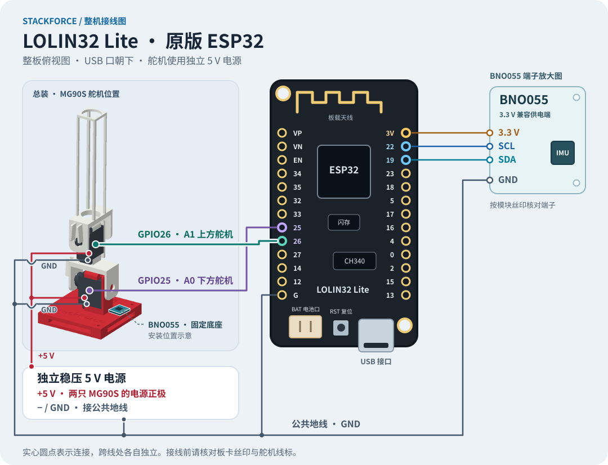
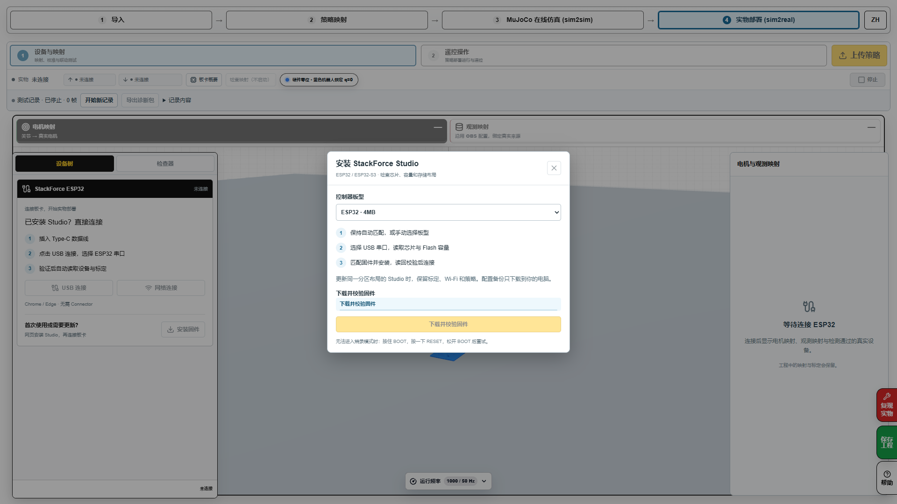
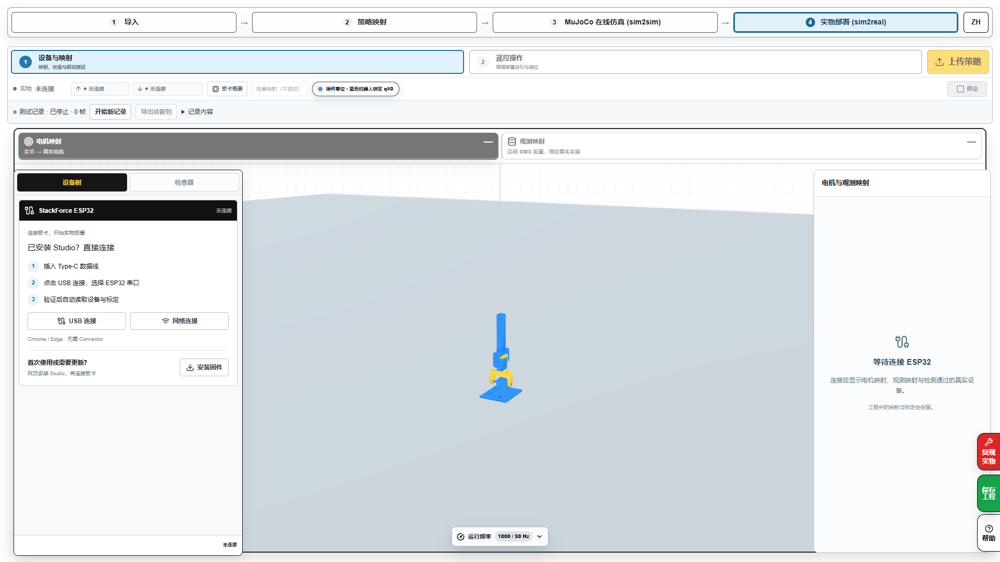
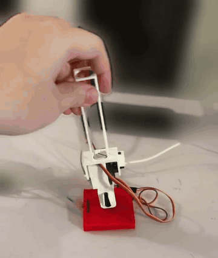

# 运行 SelfRising · 从网页仿真到 ESP32

简体中文 · [English](running.en.md) · [返回首页](../README.md) · [训练教程](training.zh-CN.md)

[下载成品固件、示例工程和本地运行包](downloads.zh-CN.md)。固件源码不在本发布范围内，已有板卡校准由各自设备保存。

从 SimReady 完成训练后，先在 Sim2Sim 验证本次模型。本教程的 ESP32 操作使用网站自带的作者原版 SelfRising 策略；新训练的 9 路输入参考策略尚待板端实机验收，状态见[训练教程第 6 步](training.zh-CN.md#6-接着部署到实物)。网页中的「上传策略」保存工程到板卡，「运行」开始执行，「停止」结束输出。

## 1. 在网页仿真里试一次

1. 打开[作者原版 SelfRising 在线仿真](https://sim2real.stackforce.cc/?example=selfrising-2axis&autoplay=0&step=mujoco&panel=simulation)。自行训练结果的交接状态见[训练教程第 5 步](training.zh-CN.md#5-进入-sim2sim)。
2. 如果弹出复现指南，点「继续当前工程」。进入「策略映射」检查两路关节与观测配置，再进入「MuJoCo 在线仿真」。
3. 点「运行」，观察模型是否实际开始物理步进。用页面提供的初始姿态或重置功能分别检查四个倒伏方向。
4. 分方向观察起立过程，确认回到目标姿态后能持续站稳。
5. 用右侧「保存工程」保存可重开的 `.sim`。需要在本地 MuJoCo 中运行时，在「本地 sim2sim 包下载」下载带模型、策略和启动器的 `-mujoco.zip`，按包内说明启动。

## 2. 准备实物工程和接线

使用支持串口访问的桌面版 Chrome 或 Edge 打开 [Sim2Real 的 SelfRising 示例](https://sim2real.stackforce.cc/?example=selfrising-2axis&autoplay=0&step=sim2real&connection=usb&panel=devices)，确认已载入作者原版策略。记录这次实物测试所用的策略版本。

| 部分 | 接线与安装 |
|---|---|
| BNO055 | 固定在红色底座；SDA → GPIO19，SCL → GPIO22，3.3 V 兼容供电端 → 3V，GND → 共地 |
| A0 下方 MG90S | 信号 → GPIO25，电源正极 → 独立 5 V，地线 → 共地 |
| A1 上方 MG90S | 信号 → GPIO26，电源正极 → 独立 5 V，地线 → 共地 |
| 独立 5 V 电源 | 负极与 ESP32、BNO055 和两只舵机共地 |
| ESP32 USB | 用 USB 数据线接电脑，供网页安装固件、上传和调试 |

## 3. 给新板卡安装固件并连接

1. 进入「设备与映射」，打开「安装固件」。点「选择板卡并安装」，在浏览器串口窗口中选择 ESP32 对应的 CH340 端口。
2. 等待写入和校验完成。烧录结束后释放安装器连接。
3. 点「USB 连接」，再次选择板卡串口。设备树应出现 BNO055 和两路 GPIO 舵机。
4. 检查板卡当前回报的运行状态。若它已经在执行已保存的工程，先点「停止」再编辑映射和校准。

## 4. 映射并校准两只舵机

1. 确认 `servo1_joint / A0 → GPIO25`，`servo2_joint / A1 → GPIO26`。
2. 从 A0 开始，打开校准，使能当前舵机并回到中位。按机械装配对齐连杆，保存零位。
3. 在联动测试中小幅改变关节目标，确认实物运动方向。需要时切换正反向并保存。
4. 检查该轴可用行程，保存后再校准 A1。

页面上的舵机标称中位为 90°。模型关节的 0 rad 对应保存后的机械零位，两者通过校准换算。GPIO 舵机的虚拟反馈表示估算角度，实际运动仍需观察。

## 5. 校准 BNO055 安装方向

1. 在设备树点 BNO055，打开机器人 IMU 三维姿态。
2. 把机器人放到模型对应的直立姿态，对照画面调整传感器相对底座的安装方向。
3. 分别轻微改变 Roll 和 Pitch，确认画面轴向与实际一致，再检查绕 Z 轴旋转。
4. 保存安装方向。需要建立本次显示参考时使用「姿态置零」，随后再次核对观测槽位的 Roll/Pitch 值。

## 6. 上传、运行和停止

1. 点「上传策略」，等待页面显示上传和验证结果。若有错误，按提示核对模型、观测和电机映射。
2. 进入「遥控操作」，点「运行」。同时检查板卡回报状态与实物动作。
3. 先试一次「停止」，确认输出结束，再重新运行。
4. 让机器人从一次受控倒伏开始，观察两只舵机完成起立并回中。分方向重复，记录每个方向的结果。

这是已有实物演示剪辑，可用于对照动作过程。[完整实拍剪辑](https://sim2real.stackforce.cc/example-media/selfrising/red-base-preview-10s.mp4)

上传成功与运行成功分别由网页显示。原版 ESP32 的可用控制方式以所安装固件和设备回报为准。本教程按 USB 完成整条流程。

## 7. 保存本次配置，方便再次测试

保存舵机和 IMU 校准后，再用网页「保存工程」下载 `.sim`。下次打开工程，连接板卡，核对设备回报的策略、映射和校准，再运行。若需要上电自启，按当前固件提供的自启设置配置，并实际断电重上电验证一次。

| 现象 | 对照检查 |
|---|---|
| 运行但舵机未动 | 查看板卡状态、两路输出映射、独立 5 V 电源和共地，再核对策略的动作输入输出 |
| 舵机反向或中位偏移 | 在设备映射中检查该轴的方向、零位和实际行程 |
| 轻微倾斜就报故障 | 读取故障原因，核对 BNO055 供电、接头和实时数据，再处理具体错误 |
| 运行时抖动 | 同时记录 IMU、策略目标与估算角度，检查机械装配和供电后定位抖动来源 |
| 换了训练策略后无法上传 | 按[训练教程第 6 步](training.zh-CN.md#6-接着部署到实物)检查新策略的全部输入输出与运行端支持 |
