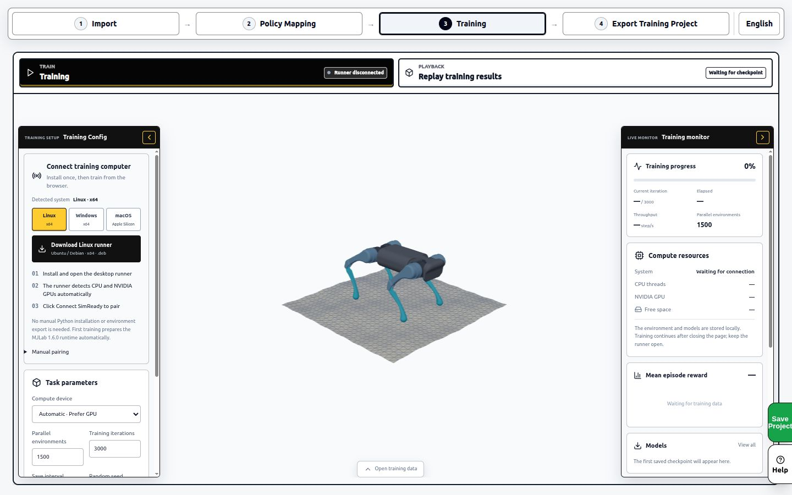
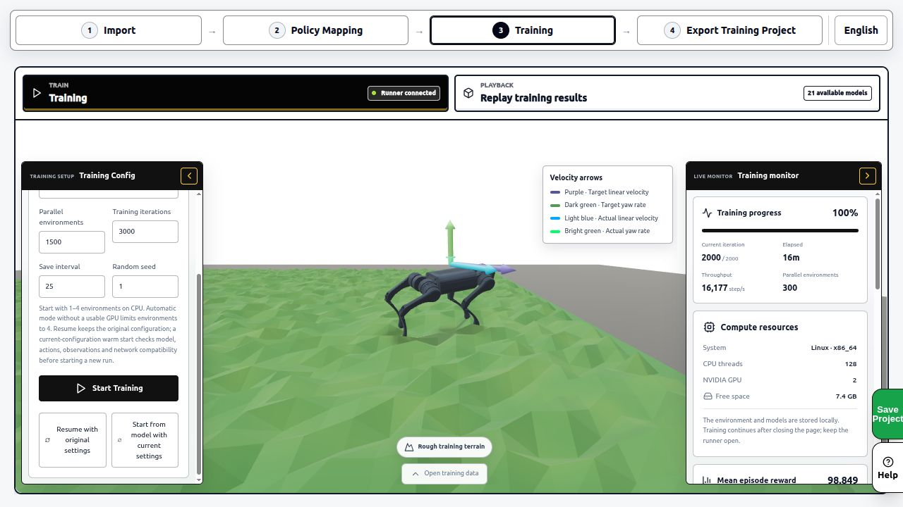
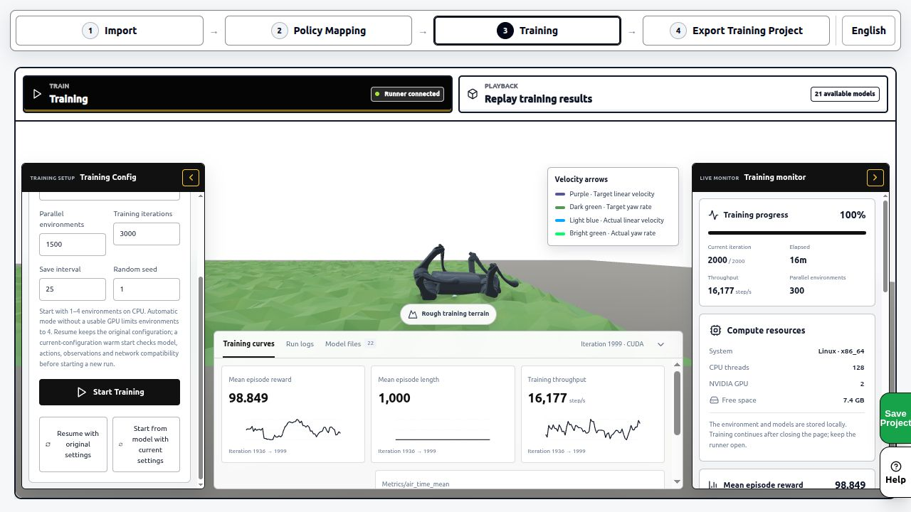
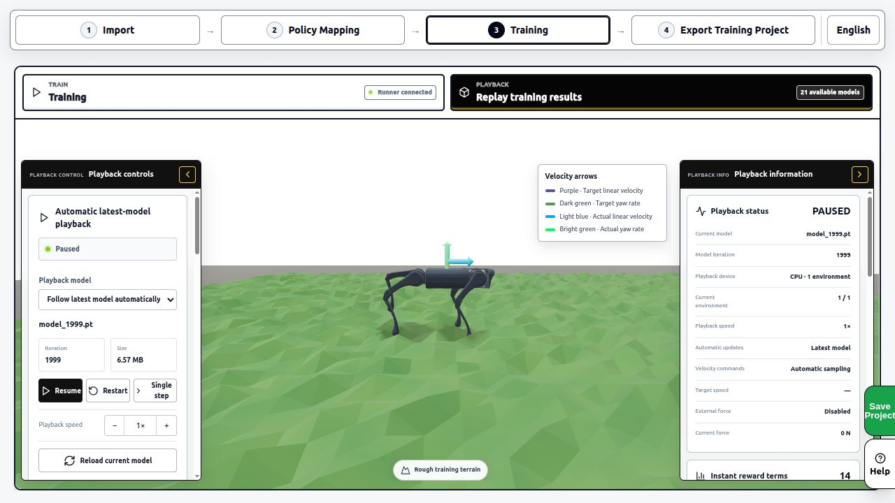
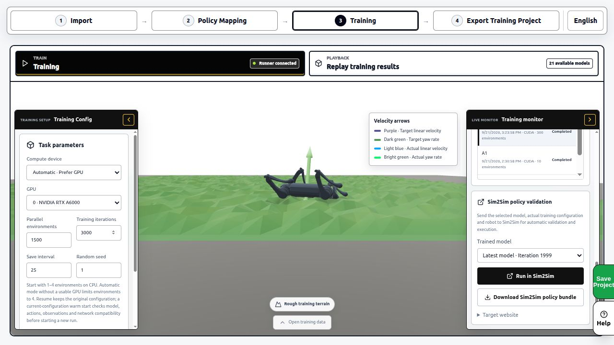

# Train SelfRising and test a recovery

[简体中文](training.zh-CN.md) · English · [Home](../README.en.md) · [Simulation and hardware guide](running.en.md)

Train, replay and evaluate a policy on your computer, then deploy a project whose inputs and outputs match the hardware. The browser provides editing and visualisation. The local Runner uses your CPU or a compatible NVIDIA GPU for training.

| Your goal | Start here |
|---|---|
| Run the assembled robot first | [Use the built-in author policy](running.en.md) |
| Learn the web training workflow and create a recovery | Steps 1–6 below |
| Reproduce the author's original PPO environment | Step 7 below |

**About the screenshots** · These are separate Chinese and English captures from SimReady's published tutorial, recorded on 2026-10-03. They show a Unitree A1 and locate the Runner, training, monitoring, playback and save controls. Use the SelfRising settings described here and in your current project. Rewards, GPU, environment counts and elapsed times shown in the images belong to historical A1 runs. [Image provenance](images/tutorial/README.md)

## 1. Open the SelfRising training project

1. Open the [SelfRising entry in SimReady](https://sim.stackforce.cc/?example=23). Check that the model is `robo1` with `servo1_joint` and `servo2_joint`. If the example order changes, find SelfRising by name in the picker.
2. Open **Policy Mapping**. Check that the two action channels correspond to those joints, then inspect the input names and their order in observation mapping.
3. Enable **Use reference motion** under special observations. Open **Reference Motions** and inspect the four recovery clips. The built-in from-scratch project includes these teaching motions.
4. Check **Training method**. **Demonstration learning (BC)** fits the reference demonstrations. **Imitate then refine (BC → PPO)** fits them first, then optimises with rewards. This pipeline needs compatible web and Runner versions.

BC learns from inputs and demonstrated actions collected in simulation. PPO improves a policy by interacting with the simulated environment and using rewards. **Reference tracking (PPO)** is another option. Review observations, rewards and training settings after changing the method.

## 2. Install and connect the local Runner

1. Open **Training**. Under **Connect training computer**, choose your operating system and download its Runner.
2. Install and open the Runner, then use **Connect SimReady** to pair it with the website.
3. Return to the website. Confirm **Runner connected** and check the detected compute resources. The first run also prepares local dependencies, with progress in the logs.



Linux is selected in this capture. On Windows, choose Windows before downloading the installer.

## 3. Review motions, observations and training settings

Inspect each reference clip's reset pose, timing and two joint targets. Use the physics preview to check the motion, then save your changes. Physics preview executes reference targets. Replay the learned policy separately in step 5.

| Setting | SelfRising from-scratch reference project |
|---|---|
| Four clips | `roll_pos`, `roll_neg`, `pitch_pos`, `pitch_neg` |
| Two actions | Incremental servo target updates at each control step |
| Joint target range | −1.55 to +1.55 rad on each axis |
| Target increment per control step | 0.08 rad |
| Physics / policy frequency | 1000 Hz / 50 Hz |
| Initial network | Random weights, 9 inputs, 2 outputs, no hidden layers |
| BC optimisation | Learning rate 0.003, batch size 768, 100 updates per iteration |
| Initial reproduction setup | 1 sampling environment, 300 iterations, save every 100, seed 42 |

The nine inputs are Roll, Pitch, the two last-commanded target caches, reference phase, two reference positions and two reference velocities, in that order. Angles use rad and time uses s. A software reference clock supplies the phase and reference targets.

For BC→PPO, also review PPO steps, exploration and reward terms. BC fits demonstrations, while PPO uses the configured rewards. Assess the saved task configuration and final evaluation for each run.

## 4. Start training and read the records

1. Use **Save Project** to save a pre-training `.simready` file.
2. Check the compute device, environments, iterations, save interval and seed on the left, then select **Start Training**.
3. Watch dependency preparation, demonstration collection and optimisation. A BC→PPO job also has a subsequent PPO stage.
4. Open the training data panel. Switch between curves, logs and model files to check that iterations advance and checkpoints are saved.



Use the table above for this example. The 1500 environments, 3000 iterations and A6000 GPU visible here belong to the A1 capture.



Elapsed time depends on the computer, dependency setup, data collection and optimisation settings. Check actual iterations, loss, episode outcomes and saved models before replaying.

## 5. Replay all four directions and save the result

1. Open **Replay training results** and select a checkpoint from this experiment.
2. Test left, right, forward and backward falls. Check recovery, return to the target pose and sustained stability.
3. Pause, single-step or restart to inspect a failure. Read the evaluation to identify the direction or condition that failed.
4. Save the complete `.simready` project. Native reference training can produce its corresponding deployment bundle with the model, ONNX, input/output configuration and training provenance.



A BC→PPO pipeline may select either BC or PPO. Check `pipeline-summary.json` for the selected stage. Keep `evaluation.json`, `training-provenance.json` and the configuration with your downloads to compare runs.



The Sim2Sim card in this image comes from the general MJLab tutorial. For a native reference policy, use the native playback and deployment bundle offered by that task. If a target site reports an unsupported contract, keep the complete project and inspect the missing capability.

## 6. Take a training result toward hardware

| Policy | Inputs and outputs | Required deployment configuration |
|---|---|---|
| Built-in author recovery policy | Wrapped ONNX has 10 inputs and 10 outputs, including 2 motor targets and 8 persistent-state channels | Author recovery controller configuration supplied with the project |
| From-scratch reference policy described here | 9 inputs and 2 outputs by default | Reference clock, clip selection, target caches and incremental target updates |

Before deploying a new policy, check every observation source, unit, update interval and action meaning on the target runtime. The nine-input reference policy still needs dedicated acceptance of its board-side reference clock. Export and simulation replay provide results for their respective stages.

To test the established ESP32 example first, follow the [running guide](running.en.md), load **StackForce SelfRising · ESP32**, then wire, map, calibrate, upload and run. Keep your training project for subsequent adaptation of your own policy.

## 7. Reproduce the author's original PPO training

The author's `RL` directory provides a MuJoCo environment, demonstration pretraining, PPO and evaluation scripts. Clone the pinned version and create a Python environment with its declared dependencies.

```powershell
git clone https://github.com/homemadegarbage/SelfRisingRobot.git
cd SelfRisingRobot
git checkout c344c2a4a1a51562247528d8aadcc0a527b6b103
cd RL
python -m venv .venv
.\.venv\Scripts\Activate.ps1
python -m pip install -r requirements.txt
```

First save a separate copy of the supplied `robo1_getup_ppo.zip`. Running `pretrain_robo1_from_scripted.py` generates a model with that name. Then run `train_robo1.py` for PPO and give its output a new name.

```powershell
python pretrain_robo1_from_scripted.py
python train_robo1.py --model-in robo1_getup_ppo.zip --timesteps 200000 --n-envs 6 --model-out selfrising-my-ppo
```

For playback, evaluation, PPO from random weights and C-header export, follow the [author's RL guide](https://github.com/homemadegarbage/SelfRisingRobot/blob/c344c2a4a1a51562247528d8aadcc0a527b6b103/RL/README.md). The author's M5Atom firmware and this website's ESP32 project each have matching runtime and input/output settings to check when transferring a model.

## Troubleshooting

| Symptom | Where to look |
|---|---|
| Runner disconnected | Open the Runner and pair the current page with Connect SimReady |
| BC or BC→PPO unavailable | Check support for the selected native reference method in both web and Runner versions |
| No successful demonstrations collected | Inspect saved motions, reset poses, physics preview and success conditions |
| Curves change but recovery fails | Select an actual saved model, replay each direction and read the evaluation |
| Wrong travel or direction after upload | Compare action units, incremental/absolute targets, channel order and calibration |
| Continue training on another computer | Save and reopen the complete `.simready` file, checking for a resumable checkpoint |
