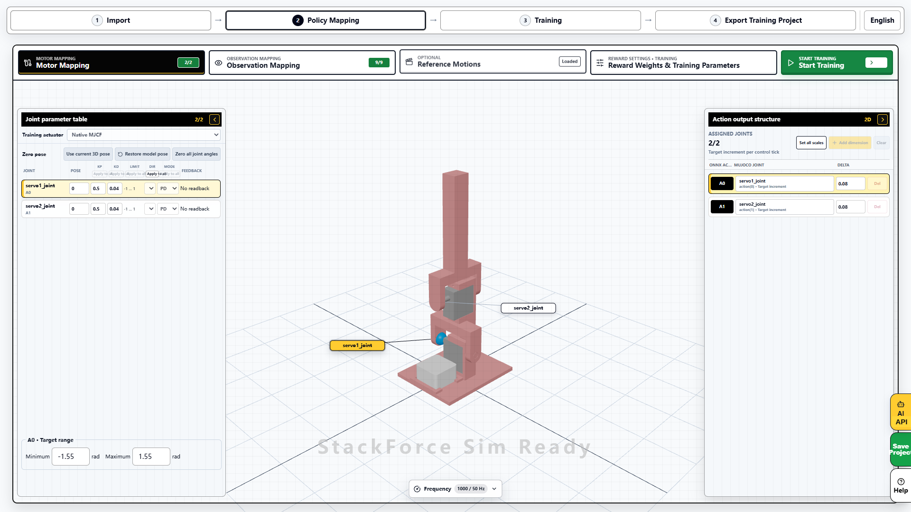
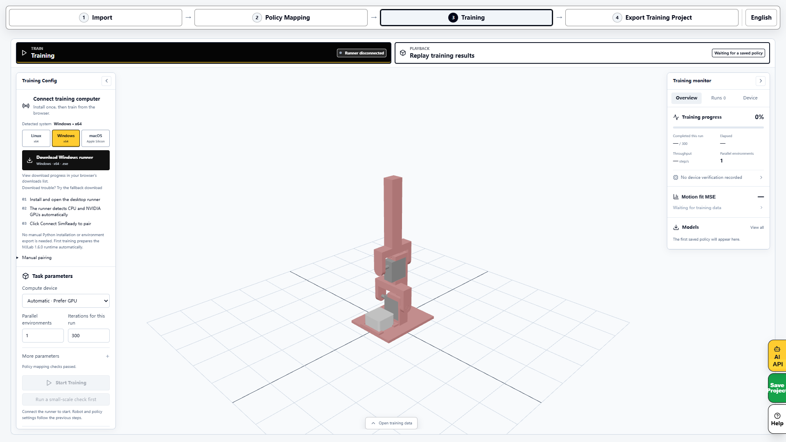
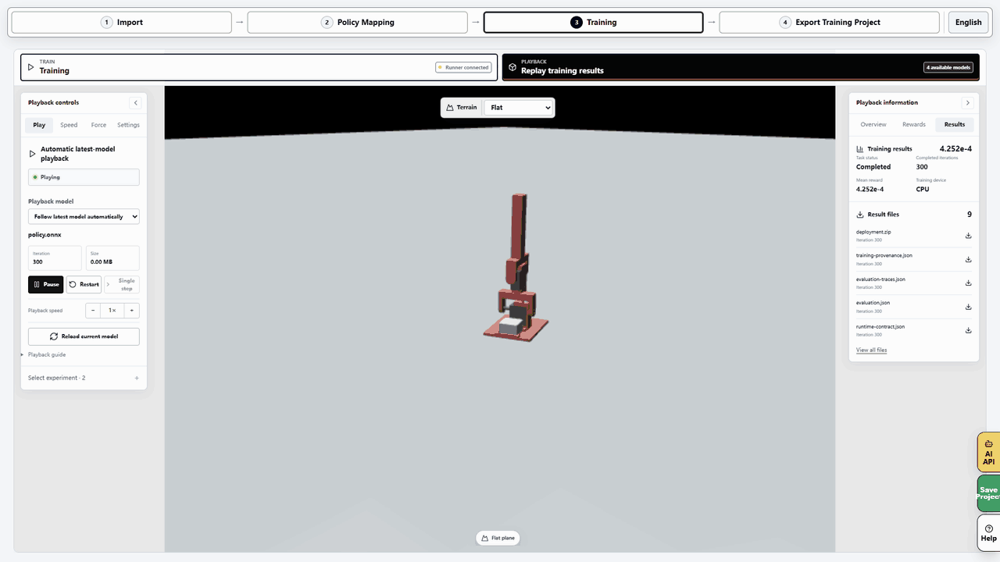
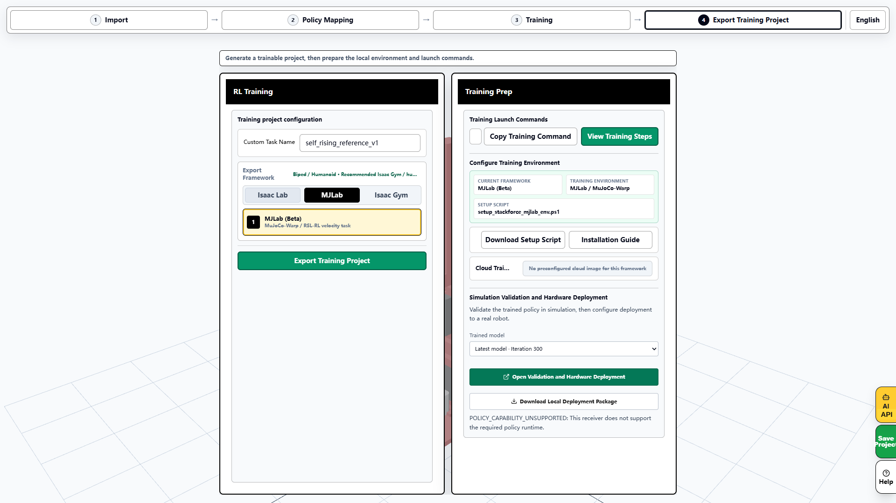
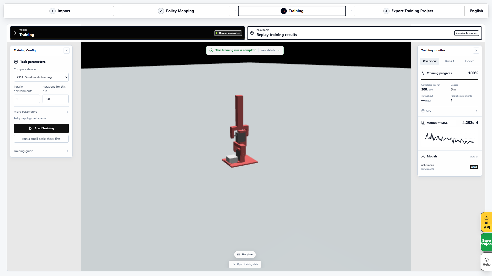

# Train and test SelfRising

[简体中文](training.zh-CN.md) · English · [Home](../README.en.md)

Follow this sequence using the same SelfRising project throughout.

**Train in SimReady → Verify in Sim2Sim → Deploy in Sim2Real.**

## 1. Select SelfRising

Open [SimReady](https://sim.stackforce.cc/?example=23) and select the Self Rising example. Check for the robot shown below, `robo1` and both servo joints, then select **Enter policy mapping**.

What should the mapping page show?

Keep the template settings for the first reproduction. Check 2/2 motor mappings and 9/9 observations. This reference-training project uses two incremental joint-target actions.

## 2. Connect the training computer

Open **Training**. Select your operating system on the left, download and open its Runner, then use **Connect SimReady** in the Runner. Continue when the website shows **Runner connected**. If the browser requests local-network access, allow the website to connect to the local Runner.

## 3. Start training

For the first run, keep the four reference clips and **Demonstration learning (BC)**. This test used CPU, one environment, 300 iterations, save interval 100 and seed 42. Find the last two settings under **More parameters**. Select **Start Training** and wait for demonstration collection and training to finish.

For reinforcement learning: switch to BC → PPO

Return to **Policy Mapping → Reference Motions**. Under **Training method**, choose **Imitate then refine (BC → PPO)**, then start a new task in **Training**. BC first learns the reference motions; PPO then optimises using rewards. Replay and evaluate the new result afterward.

The complete run recorded here used default BC. The image below shows the actual BC → PPO configuration entry; it does not claim a completed PPO run.

## 4. Replay this run

Open **Replay training results** and select this run's `policy.onnx`. Check that the left panel says **Playing**, then observe recovery from left, right, forward and backward falls. Download evaluation files from **Results** on the right. After checking sustained stability, use **Save Project** to download the complete `.simready` file.

## 5. Open Sim2Sim

Open **Export Training Project** at the top. Find **Simulation Validation and Hardware Deployment** near the bottom, select this run's model and choose **Open Validation and Hardware Deployment**. Use **Download Local Deployment Package** to retain the `.sim2sim` handoff file.

**Test status on 2026-11-09:** default-reference training, playback and package export passed. Automatic handoff returned `POLICY_CAPABILITY_UNSUPPORTED`: the receiver does not yet implement the bundle's peripheral recovery controller. Keep the exported files; this message does not confirm a running simulation.

What does the compatibility message look like?

## 6. Continue to hardware

The training example uses nine inputs, including a software reference clock. ESP32 hardware validation of this newly trained policy is still pending.

For hardware testing now, follow the [running guide](running.en.md) with the author's original policy supplied with the website. Keep your trained project separately and record the policy version actually used on hardware.

About BC, PPO and exported files

BC learns from demonstrations collected by executing reference motions in simulation. PPO then adjusts the policy using rewards. The reference project also observes target caches and a software reference clock, which need their matching runtime configuration on deployment.

Use `.simready` to save and continue training and `.sim` to reopen a simulation or deployment project. ONNX carries the network. Transfer its model, observations, actions and runtime configuration with the project.

For the author's Python training workflow, see the [original RL guide](https://github.com/homemadegarbage/SelfRisingRobot/blob/c344c2a4a1a51562247528d8aadcc0a527b6b103/RL/README.md).

Test record and screenshot sources

Pairing, training, live replay, project saving and package download were operated on the actual website on 2026-11-09. The Runner used pinned source in an isolated environment; its desktop installer was not tested in this session. With MuJoCo 3.11.0, random initial weights, CPU and 300 BC iterations, all four nominal starting poses recovered in 2.22 / 2.22 / 2.82 / 2.90 seconds. These results cover the specified simulated poses. Hardware performance needs separate validation.

See the [test record](training-evidence.json) for parameters, policy hash and scope, and [screenshot sources](images/tutorial/README.md) for capture details.

