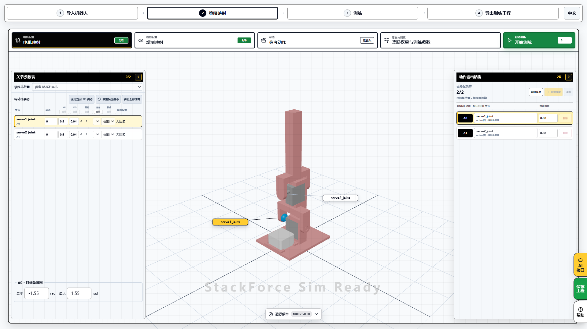
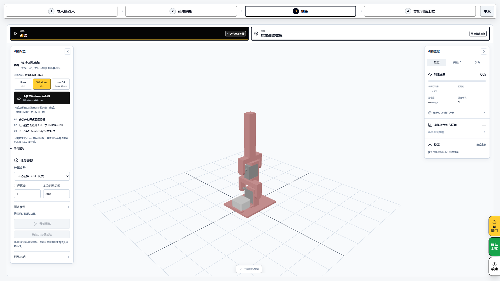
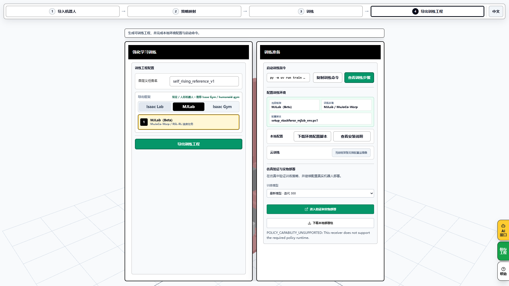
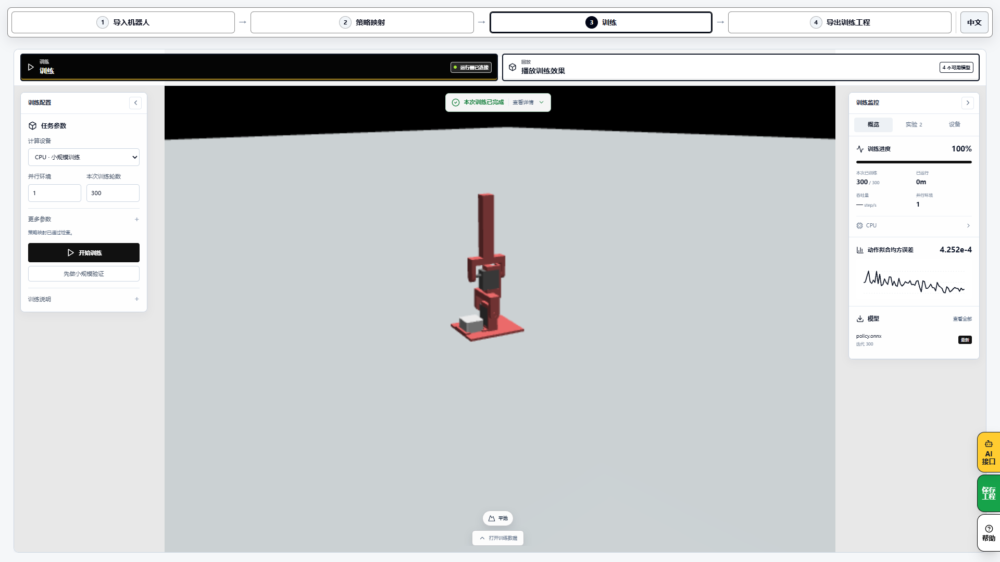

# 用 SelfRising 跑通训练与仿真

简体中文 · [English](training.en.md) · [首页](../README.md)

按这条顺序操作，整个过程使用同一个 SelfRising 工程。

**SimReady 训练 → Sim2Sim 验证 → Sim2Real 部署。**

## 1. 选择 SelfRising

打开 [SimReady](https://sim.stackforce.cc/?example=23)。在示例工程里选择「强化学习不倒翁 · Self Rising」。看到图中的机器人、`robo1` 和两个舵机关节后，点「进入策略映射」。

进入映射后应该看到什么？

首次复现保留模板配置。确认电机映射为 2/2、观测映射为 9/9；这份参考训练工程的两路动作是关节目标角增量。

## 2. 连接训练电脑

点顶部「训练」。在左侧选自己的系统，下载并打开 Runner，再点 Runner 中的「连接 SimReady」。网页显示「运行器已连接」后继续。浏览器询问本机网络访问时，允许此网站连接本机运行器。

## 3. 开始训练

第一次使用先沿用 SelfRising 示例的四段参考动作和「示范学习（BC）」。本次实测使用 CPU、1 个并行环境、300 轮、保存间隔 100、随机种子 42。参数在左侧，「保存间隔」和「随机种子」位于「更多参数」。点「开始训练」，等待示范采集和训练完成。

要做强化学习：切换到 BC → PPO

返回「策略映射 → 参考动作」，在「训练方式」里选「模仿后强化（BC → PPO）」，再进入「训练」开始新任务。BC 先学习参考动作，PPO 再按奖励优化。修改后生成的是新训练结果，需要重新回放和验收。

本次完整运行记录覆盖默认 BC；下图展示实际的 BC → PPO 配置入口，未将它标成已完成的 PPO 训练。

## 4. 回放这次的结果

点「播放训练效果」，选这次训练保存的 `policy.onnx`。确认左侧显示「正在播放」，分别查看左倒、右倒、前倒、后倒的起立过程。右侧「结果」可以下载评估文件。确认起立后能站稳，再点「保存工程」下载完整 `.simready`。

## 5. 进入 Sim2Sim

点顶部「导出训练工程」，在页面下方找到「仿真验证与实物部署」。选择本次保存的模型，点「打开仿真验证与实物部署」。需要保留交接文件时，点旁边的「下载本地部署包」，得到 `.sim2sim`。

**当前实测状态（2026-11-09）：** 默认参考策略的训练、回放和部署包导出已通过；自动交接返回 `POLICY_CAPABILITY_UNSUPPORTED`。接收端还不支持包中要求的外层恢复控制器。保留导出的文件，当前不能把这个提示视为仿真运行成功。

兼容提示是什么样？

## 6. 接着部署到实物

训练示例使用 9 路输入，包含软件参考时钟。这条新训练策略的 ESP32 实机验收尚未完成。

现在想装机测试，可以按[实物运行教程](running.zh-CN.md)部署网站自带的作者原版策略。自己的训练工程另行保留，记录实物测试时实际使用的策略版本。

想了解 BC、PPO 和导出文件

BC 学习参考动作在仿真中产生的示范。PPO 再按奖励调整策略。参考工程的观测还包括目标角缓存和软件参考时钟，部署时需要保留对应的运行配置。

`.simready` 用来保存和继续训练，`.sim` 用来重开仿真或部署工程。ONNX 携带网络，模型、观测、动作和运行配置随工程一起交接。

要复现作者的 Python 训练流程，查看[作者 RL 说明](https://github.com/homemadegarbage/SelfRisingRobot/blob/c344c2a4a1a51562247528d8aadcc0a527b6b103/RL/README.md)。

本次实测记录与截图来源

2026-11-09 在实际网站上操作配对、训练、回放、工程保存和部署包下载。运行器使用独立环境中的固定版本源码，本轮没有验收桌面安装器。MuJoCo 3.11.0，随机初始化，CPU，300 轮；四个标称初态均起立成功，分别为 2.22 / 2.22 / 2.82 / 2.90 秒。该结果覆盖规定仿真初态，实物表现需要另行验证。

完整参数、策略哈希及验收范围见[实测记录](training-evidence.json)，图片来源见[截图说明](images/tutorial/README.md)。

