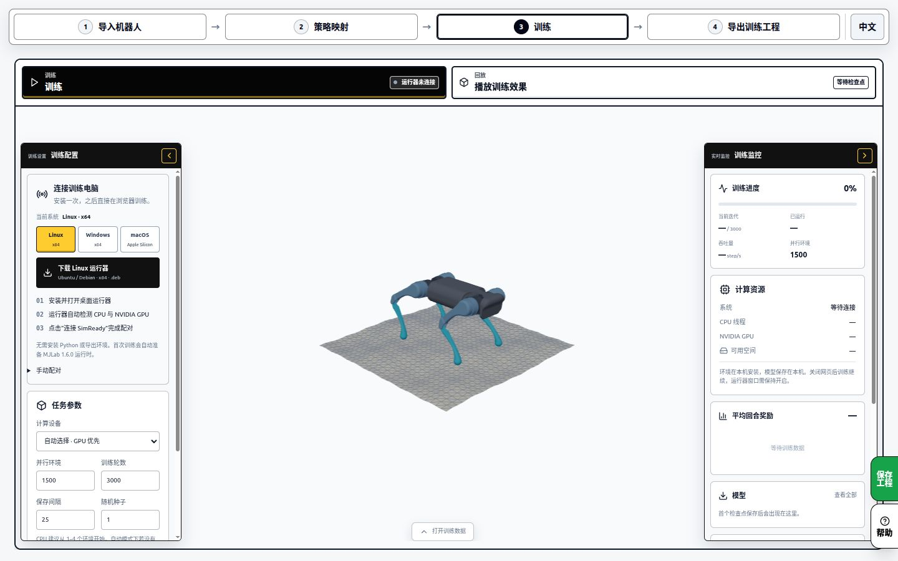
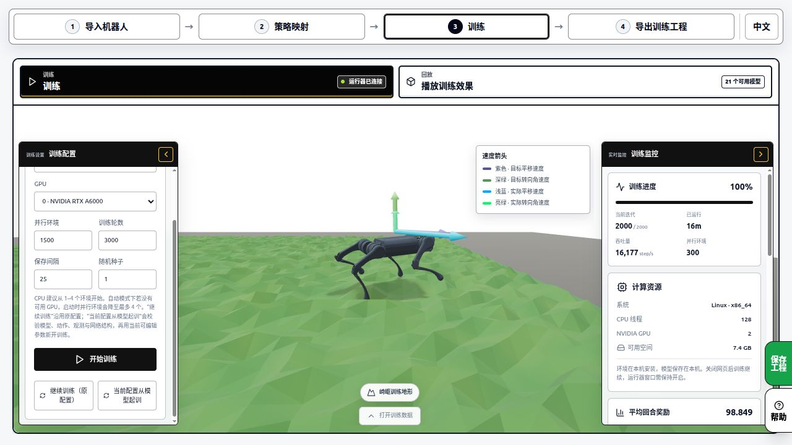
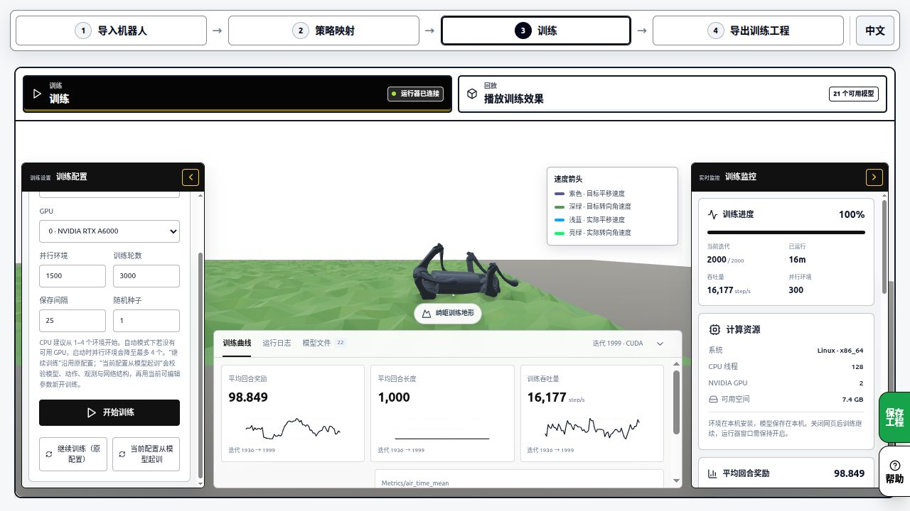
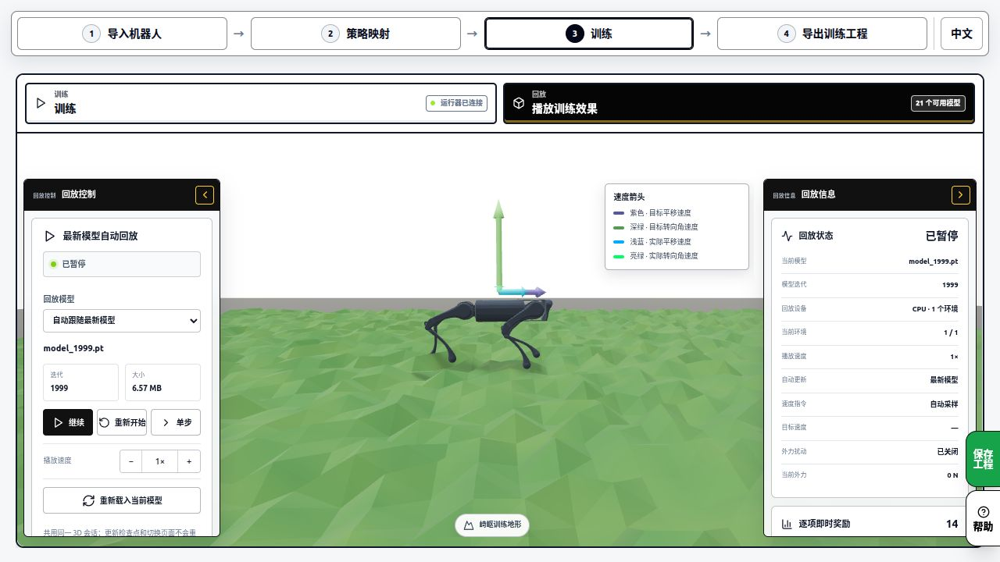
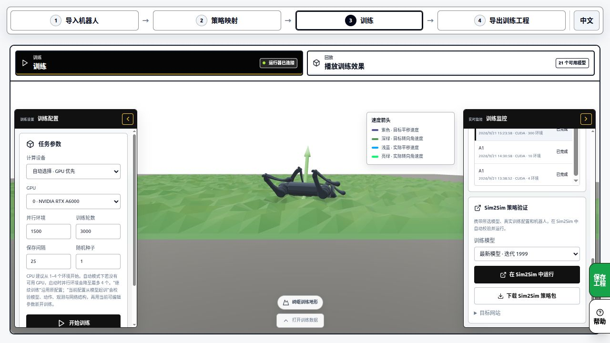

# 从训练到起立 · SelfRising

简体中文 · [English](training.en.md) · [返回首页](../README.md) · [仿真与实物运行](running.zh-CN.md)

在电脑里训练、回放并检查策略，再把匹配实物输入输出的工程部署到 ESP32。浏览器负责编辑和显示，本地 Runner 使用电脑的 CPU 或兼容的 NVIDIA GPU 进行训练。

| 你想做什么 | 从这里开始 |
|---|---|
| 先让已装好的机器人运行 | [使用内置作者策略](running.zh-CN.md) |
| 学习网页训练并制作自己的起身动作 | 本页第 1–6 步 |
| 复现作者的原始 PPO 训练环境 | 本页第 7 步 |

**截图说明** · 本页使用 SimReady 已发布教程中的中英文独立截图，原始采集日期为 2026-10-03，画面中的机器人是宇树 A1。它们用于定位下载运行器、训练、监控、回放和保存入口。SelfRising 的设置以本页文字和当前工程为准。图中的奖励、GPU、环境数和用时属于 A1 的历史实验。[截图来源](images/tutorial/README.md)

## 1. 打开 SelfRising 训练工程

1. 打开 [SimReady 的 SelfRising 入口](https://sim.stackforce.cc/?example=23)。确认模型为 `robo1`，关节为 `servo1_joint` 和 `servo2_joint`。若示例顺序调整，在选择器里按名称查找不倒翁。
2. 进入「策略映射」，检查两路动作分别对应这两个关节。查看「观测映射」中的输入名称与顺序。
3. 在「特殊观测」开启「使用参考动作」，进入「参考动作」检查四个起立片段。使用内置从零工程时，这些片段已作为教学素材提供。
4. 查看「训练方式」。选择「示范学习（BC）」可先学会模仿参考动作。选择「模仿后强化（BC → PPO）」会先拟合示范，再按奖励继续优化。该流程需要兼容的网页和 Runner。

BC 使用仿真采集到的输入与示范动作训练网络。PPO 通过与仿真环境交互、根据奖励更新策略。「参考跟踪强化学习（PPO）」也是可选方式，调整后要重新检查观测、奖励和训练配置。

## 2. 安装并连接本地 Runner

1. 进入顶部「训练」，在左侧「连接训练电脑」选择自己的系统，下载对应的 Runner。
2. 安装并打开 Runner，使用其中的「连接 SimReady」完成网页配对。
3. 回到网页，确认出现「运行器已连接」，并能看到计算资源。第一次训练还会准备本地依赖，进度可在日志中查看。



图中选中的是 Linux。Windows 用户在左侧选择 Windows，再下载对应安装包。

## 3. 检查动作、观测与训练设置

打开参考动作逐段检查初始姿态、时间和两路关节目标。可以先用物理试演查看动作能否完成起立，再保存修改。物理试演执行参考目标，训练后的策略要在第 5 步单独回放。

| 设置 | SelfRising 从零参考工程的配置 |
|---|---|
| 四个参考片段 | `roll_pos`、`roll_neg`、`pitch_pos`、`pitch_neg` |
| 两路动作 | 每个控制周期更新舵机目标角的增量 |
| 关节目标范围 | 每轴 −1.55 到 +1.55 rad |
| 每周期目标增量 | 0.08 rad |
| 物理与策略频率 | 1000 Hz / 50 Hz |
| 初始网络 | 随机权重，9 个输入、2 个输出，隐藏层为空 |
| BC 优化 | 学习率 0.003，批量 768，每轮 100 次梯度更新 |
| 初次复现设置 | 1 个采样环境，300 轮，保存间隔 100，种子 42 |

九个输入依次是 Roll、Pitch、两路最后发送的目标角缓存、参考进度、两路参考目标角和两路参考速度。角度使用 rad，时间使用 s。参考进度和参考目标来自软件参考时钟。

选择 BC→PPO 时，还需检查 PPO 的训练步数、探索幅度和奖励项。BC 阶段拟合示范，PPO 阶段按奖励优化。以本次任务保存的配置和最终评估结果判断效果。

## 4. 开始训练并阅读记录

1. 先用「保存工程」保存一份训练前的 `.simready` 文件。
2. 在左侧核对计算设备、环境数、训练轮数、保存间隔和种子，然后点「开始训练」。
3. 观察依赖准备、示范采集和优化进度。BC→PPO 任务还会显示后续 PPO 阶段。
4. 打开底部的训练数据，在曲线、运行日志和模型文件之间切换，确认实际迭代推进且已保存检查点。



本例按上表设置。图中的 1500 个环境、3000 轮和 A6000 显卡属于 A1 截图。



训练时长取决于电脑、依赖准备、采集次数和优化设置。检查记录中的实际迭代、loss、回合结果和已保存模型，再进入回放。

## 5. 回放四个方向并保存结果

1. 切换「播放训练效果」，选择本次实验保存的检查点。
2. 分别测试左右侧倒、前倒和后倒。检查是否完成起立、回到目标姿态并持续站稳。
3. 用暂停、单步和重新开始观察失败时刻。结合评估文件检查是哪一个方向或哪一项条件没有达到。
4. 保存完整 `.simready` 工程。原生参考训练可导出配套的部署包，保留模型、ONNX、输入输出配置和训练来源记录。



BC→PPO 的最终产物可能选中 BC 或 PPO，以任务的 `pipeline-summary.json` 为准。下载产物后保留 `evaluation.json`、`training-provenance.json` 和相关配置，便于比较不同次训练。



图中的 Sim2Sim 卡片来自通用 MJLab 教程。原生参考策略按该任务提供的原生回放与部署包路径操作。若目标网站报告不支持该合同，保留完整工程并查看具体缺失项。

## 6. 从训练结果走向实物

| 策略 | 输入输出 | 部署时要对应的内容 |
|---|---|---|
| 网站内置作者起立策略 | 包装后的 ONNX 为 10 输入、10 输出，其中 2 路控制舵机，8 路保存状态 | 工程自带的作者起立控制配置 |
| 本页从零参考训练策略 | 默认 9 输入、2 输出 | 参考时钟、片段选择、目标角缓存和增量动作更新 |

为新策略部署前，先在目标运行端逐项核对全部观测来源、单位、更新周期和动作语义。九输入参考策略的板端参考时钟流程仍需专门验收。网页成功导出和仿真回放分别提供相应阶段的结果。

要先测试当前已跑通的 ESP32 例子，按[运行教程](running.zh-CN.md)加载「强化学习不倒翁 · ESP32」，完成接线、映射、校准、上传和运行。保留训练工程，便于后续适配自己训练的策略。

## 7. 复现作者的原始 PPO 训练

作者仓库的 `RL` 目录提供 MuJoCo 环境、示范预训练、PPO 和评估脚本。先克隆并固定版本，再按该目录的依赖说明建立 Python 环境。

```powershell
git clone https://github.com/homemadegarbage/SelfRisingRobot.git
cd SelfRisingRobot
git checkout c344c2a4a1a51562247528d8aadcc0a527b6b103
cd RL
python -m venv .venv
.\.venv\Scripts\Activate.ps1
python -m pip install -r requirements.txt
```

先将随包的 `robo1_getup_ppo.zip` 另存一份。用 `pretrain_robo1_from_scripted.py` 从参考动作预训练时，会生成同名模型；之后用 `train_robo1.py` 进行 PPO，并将 PPO 输出写到新文件名。

```powershell
python pretrain_robo1_from_scripted.py
python train_robo1.py --model-in robo1_getup_ppo.zip --timesteps 200000 --n-envs 6 --model-out selfrising-my-ppo
```

播放和评估参数、从随机权重开始 PPO 的用法，以及 C 头文件导出方法，见[作者 RL 说明](https://github.com/homemadegarbage/SelfRisingRobot/blob/c344c2a4a1a51562247528d8aadcc0a527b6b103/RL/README.md)。作者的 M5Atom 固件和本站 ESP32 工程各自带有配套输入输出及运行配置，迁移模型时一并核对。

## 遇到问题

| 现象 | 检查位置 |
|---|---|
| 运行器未连接 | 打开 Runner，用「连接 SimReady」配对当前网页 |
| BC 或 BC→PPO 不可用 | 核对网页、Runner 是否支持所选原生参考训练方式 |
| 没采集到成功示范 | 检查保存后的参考动作、初态、动力学试演和成功条件 |
| 曲线有变化但起不来 | 选择实际保存的模型，逐方向回放并查看评估结果 |
| 上传后动作幅度或方向错误 | 对比动作单位、增量/绝对目标、通道顺序和实物校准 |
| 想换电脑继续训练 | 保存并重开完整 `.simready`，核对其中是否含可继续训练的检查点 |
